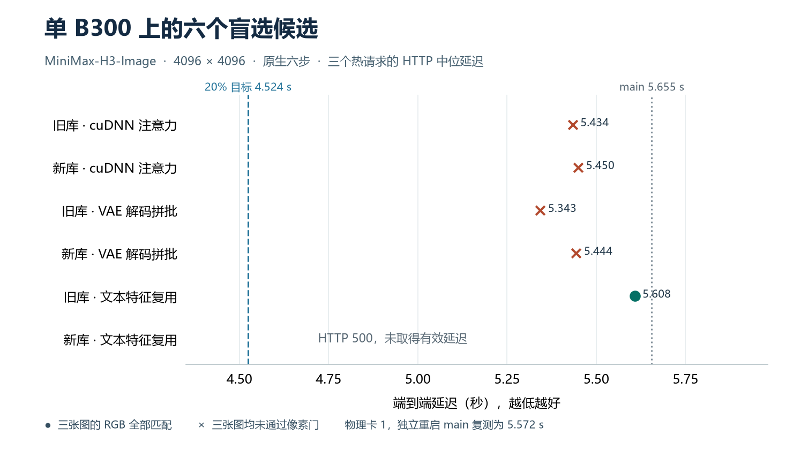

# MiniMax-H3-Image 单 B300 性能与 InferRSI 知识库对照

本次试验回答两个问题。第一，固定 vLLM-Omni main、模型版本、4096²、原生六步和精度，单卡热请求能否在三个种子像素逐字节一致的前提下，把端到端中位延迟降低 20%。第二，同预算的调查者使用新旧知识库，能否更快找到更适用的证据。[冻结条件与复现命令](plan/README.md) · [知识库分层、目录、搜索及前后对照图](../../docs/knowledge-layout.md)

## 新旧知识库实际找到什么

| 指标 | 老目录 | 单一 skill_library 目录 |
| --- | ---: | ---: |
| 独立调查者 | 1 | 1 |
| 调查用时（秒） | 420.149 | 406.982 |
| 首条影响候选筛选的类比证据（秒） | 58.918 | 46.570 |
| 提出的机制 | 3 | 3 |
| 从材料追溯到候选实现的正向类比 | 2 | 2 |
| 查到完整目标条件的实测材料 | 0 | 0 |

两组独立提出了同样的三种机制。注意力后端切换来自固定版本的代码。库中 Q/K 融合记录帮助排除了已经合入 main 的优化。VAE 分块来自单 B300 **视频** VAE 的类比；文本特征复用来自另一模型在 Ascend 上的图像推理记录。模型阶段、卡数、精度和已合入代码决定这些记录能支持多强的结论。[逐条调查记录](results/retrieval.json)

旧组计入了 2 次 Find 和 4 次材料读取，共 9.542 秒。新组计入了 2 次 Find、3 次材料读取、1 次主技能调用和 1 次失败启动，共 12.330 秒。其中失败启动占 0.876 秒。旧组也遇到启动器缺少 manifest，把这部分记在入口检查。两侧调查用时还包含阅读代码和任务调度。每库一名调查者，支撑的是本任务的过程记录。

在同一台 Windows 主机上又做了固定查询回放。每个查询在旧、新两个冻结 worktree 各起 4 个新的 Python 进程，关闭外部搜索，两种先后顺序各用两次。**6/6 个查询的前五个 ID 及次序完全一致。** 五个事先指定的导航目标在两库中的名次依次为 1、1、1、2、1。全体 24 个样本的端到端 CLI 中位数为旧库 1.669 秒、新库 1.682 秒。首个查询用于检查这一特定运行条件的材料缺口。这个回放没有显示搜索准确率或延迟优势。[原始排名与逐次时间](results/fixed-find.json) · [回放脚本](validator/replay_find.py)

## 六个独立候选

下表中的筛选共用物理卡 1。main 中位数 5.655 秒，独立重启为 5.572 秒，三个种子的 RGB 完全一致。计时终点是完整 HTTP 响应到达客户端。冷启动、首次预热以及客户端计算哈希均单列。先前物理卡 0 的两次 main 为 5.604 和 5.629 秒，另有一项测量在有外来进程进入时被剔除。

| 机制 | 旧库候选 | 新库候选 | 单卡实测 |
| --- | --- | --- | --- |
| 默认 TRTLLM 注意力改为 cuDNN | A1，环境变量 | B1，显式默认后端 | 5.434 / 5.450 秒。两种入口均切换了目标后端，均为 0/3 图像匹配。 |
| 以四块为一批解码 VAE | A2，按形状分组重放图 | B2，按顺序拼批后解码 | 5.343 / 5.444 秒。均为 0/3 图像匹配。 |
| 六步之间复用文本特征 | A3，请求内列表 | B3，请求内字典 | A3 为 5.608 秒，3/3 图像匹配。B3 首版漏注册前向参数，HTTP 500。原始补丁及修正版分别留存，修复不计入原始盲选成绩。 |

筛选中最快的合格候选 A3 又做了同卡反序复测，依次启动 main、A3、A3、main 四个服务。两对端到端延迟降幅分别为 **0.043% 和 0.257%**，四个服务各自的三张图均逐像素一致。筛选时看到的 0.84% 降幅没有在复测中重现，两种顺序都远低于 20% 目标。初次复测曾因外来进程与 GPU 利用率读数的短暂滞后而中断。最后的同卡比较保留了完整的 AB1，以及由同一冻结 validator 新生成的 AB2、BA1 和 BA2。每次均重新检查设备空闲并开启进程监控。

新版本 InferRSI 的 `campaign round` 另外对 B3 修正版 B3R 执行了质量对照和两次反序测量。同卡 main 为 5.652 / 5.580 秒，候选为 5.553 / 5.640 秒，均为 3/3 像素匹配。相对降幅依次为 **+1.75% 和 −1.08%**。按两次服务中位数汇总后的降幅约 **0.34%**。InferRSI 判为 `FAIL / performance_gate_not_met`，保留 main。[逐次测量及哈希](results/hardware.json) · [结果复算程序](validator/summarize.py)

## 两项额外工程试验

盲检索结束后，又测试了两个保持原生数值运算的候选。其结果单独归因于后续工程分析。

| 候选 | 同卡 main → 候选 | 结果 |
| --- | --- | --- |
| C7，将 SM103 图像 VAE 的图重放副本从 6 增至 12 | 卡 1，5.655 → 5.603 秒 | 3/3 图像匹配，单次筛选快 0.93% |
| E8，将 21×21 个 VAE 解码块的拼接按行合并，同时保留融合顺序 | 卡 0，5.529 → 5.554 秒 | 3/3 图像匹配，单次筛选慢 0.44%。4096² CPU 用例的融合调用从 840 降至 62。 |

两项均未达到 20%；每项的单次筛选不支持推广为稳定提速。[候选补丁](patch) · [E8 的 CPU 逐字节对照](results/e8-cpu-report.json)

## 怎样使用这次重构

同步阶段 profiler 对三个热请求测得中位数：六步去噪 **4.580 秒**、VAE 解码 **0.686 秒**、文本编码 **0.022 秒**，整段 `forward` **5.344 秒**。这是开启同步探针的独立诊断运行，三张图均通过原质量门。按约 5.6 秒的主基线，达到 20% 需要省约 1.12 秒；即使完全消除本次 VAE 解码时间，单靠该阶段也不够。若其余时间固定，六步去噪需缩短约四分之一。[阶段探针配置](validator/stage-profile.json)

1. 用用户要验收的结果选主技能。此例先执行 `inferrsi skills enter task-performance`，写清模型 revision、设备和卡数、运行栈、分辨率、步数、精度、输出质量以及时延边界。模型模态、硬件和 OS 是检索条件，在不同任务间复用。
2. 对未知资料用 Find，对已知资料直接用 ID 和 revision 读取原文。核对上述条件后再赋予证据等级。完整匹配可以安排重放，部分匹配用于提出假设，已经合入 main 的机制用于排除重复劳动。现有实现由调查者核对这些条件。可以把条件匹配和不匹配原因显示在未来的搜索结果中。
3. 把真实任务的正反结果、固定版本、补丁和验证器放进证据目录。维护者审核后，可在唯一的 `skill_library` 原文位置登记该案例，引用此证据。这样下次遇到相同请求就能打开实际单卡图像结果。此次盲测冻结了两套输入，登记新材料后的召回需另做评估。
4. 用独立留出的任务检验收益，覆盖七类主任务和多个硬件、模态。比较同一查询预算下的完整条件命中率、首条可用材料耗时、错误跨条件引用，以及独立复现结果。若新旧库仍给出相同排序，报告维护收益与材料缺口，继续保留真实的检索差异。

Claude Code 的 Fable 5.2（Extra）提出用 A/A 和反序服务复测识别噪声，并要求公开负结果。Codex 用实际材料链路质询了“相同机制意味着搜索已饱和”的推断，并澄清完整运行条件与候选机制组合是两件事。双方复核后，实验保留原始的三种机制、跨条件类比、坏补丁以及像素门失败。两个 A/A 数值只描述观测到的波动；统计检出的最小效应仍需更多独立重复。
