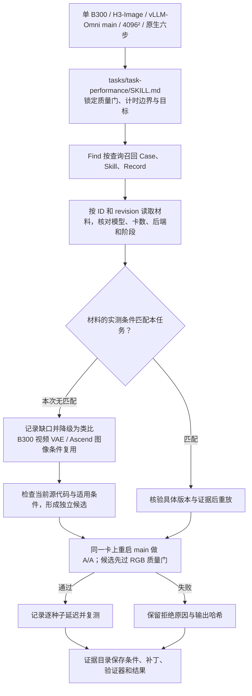

# Single-B300 H3 Image field validation

[Protocol published before the first timed GPU output](https://github.com/InferMatrixLab/InferRSI/issues/515#issuecomment-7006259946).

| Input | Frozen value |
| --- | --- |
| Control knowledge checkout | `a3e33851981f1ecdc8b73d7b62633cc598e5d5ae` |
| Proposed knowledge checkout | `c27a359d0ec5c11551b3d4c77ddfa3068cbf1c36` |
| Baseline engine | [vLLM-Omni main at campaign start](https://github.com/vllm-project/vllm-omni/commit/51f54de16b08416182926b8f071034422561f99c) |
| Model | [MiniMax-H3-Image snapshot](https://huggingface.co/MiniMaxAI/MiniMax-H3-Image/tree/8ced60068623def5b74b4d10558117cb61d6482d) |
| Device and software | One NVIDIA B300 SXM6 AC per run, SM 10.3, driver 610.43.02, PyTorch 2.14.0 with CUDA 13.0, vLLM 0.34.0, FlashInfer 0.7.3, Diffusers 0.40.0, Transformers 5.19.0, Pillow 13.0.0 |
| Inputs | Text-to-image, 4096 × 4096, six native steps, BF16, serial batch one. Seed 42 warms the service. Each of seeds 43–45 uses a different fixed prompt. The prompts and HTTP payload are in [trial.py](../validator/trial.py). |
| Primary metric | Median wall time from issuing the local HTTP request to receiving the complete response, including PNG generation, base64 encoding and transport. Client decoding, hash computation, startup and warmup are outside the timer. |
| Gate | At least 20% lower latency, calculated as `1 − candidate / main`, with all three decoded RGB hashes equal to the matching same-card main reference. Detect device contention at admission and during execution. |
| Investigation budget | Up to eight knowledge calls and three executable nominations per investigator. Source inspection and CPU checks are separate. Only the coordinator sees both arms before GPU measurements. |

## How to reproduce a pair

Create two worktrees at the pinned engine revision. Leave one clean. For a source candidate, apply its file from [patch](../patch) to the other worktree. For an attention candidate, use the corresponding JSON as the trial configuration. Install the pinned model's native transformer, VAE, text encoder, tokenizer, processor and PDD files under a single snapshot directory.

```bash
python validator/trial.py --project "$MAIN" --model "$SNAPSHOT" --gpu "$GPU" --out "$RUN/main"
python validator/trial.py --project "$MAIN" --model "$SNAPSHOT" --gpu "$GPU" \
  --reference "$RUN/main/trial.json" --out "$RUN/main-repeat"
python validator/trial.py --project "$CANDIDATE" --model "$SNAPSHOT" --gpu "$GPU" \
  --reference "$RUN/main/trial.json" --out "$RUN/candidate"
```

For A1 or B1 append `--config patch/A1-attention.json` or `--config patch/B1-attention.json`. Each output directory must be new. Confirm that the worker resolved the intended attention implementation before attributing a configuration effect. For confirmation, repeat the candidate and main in reverse order, each in a fresh service. Keep the same physical card within a pair. If a foreign process arrives, discard that measurement and record the interruption. A different card needs its own baseline and A/A quality control.

The frozen trial validator has SHA-256 `f9e442cf6050026bd29f8c0e598a95d7d7f840bc594eab43be92c0c75531901c`. The InferRSI measurement adapter has SHA-256 `f439d3bf1531fcf45a040114cad6f5586d62be272a92a4a5807ee415607d4f3b`. The recorded request-level data retain the raw trial file hash, decoded RGB hashes and full-precision seconds. Intermediate PNGs and private host logs stay on the experiment host. To recalculate the comparisons from the published samples, run `python validator/summarize.py` from this evidence directory.

## How the two knowledge paths were used

Each investigator inspected only their assigned knowledge snapshot and the common engine revision. The new arm entered `task-performance` before searching. Both sought matching evidence, followed material references and compared each proposal against the current implementation. The two controllers used their own installed-source snapshots for `campaign start` and `campaign knowledge`. The investigations used open-ended language queries, so their elapsed times include investigator scheduling. The local clocks and launcher accounting differ between investigators. The CPU checks test code structure. Only a complete, uncontaminated GPU run can supply a target latency.

For the as-built task, storage and retrieval diagrams, see [the architecture design](../../../docs/knowledge-layout.md).



The matching decision in this diagram is performed by the investigator after reading the evidence. Automated model/version/card-count matching would require a separate retrieval change.
