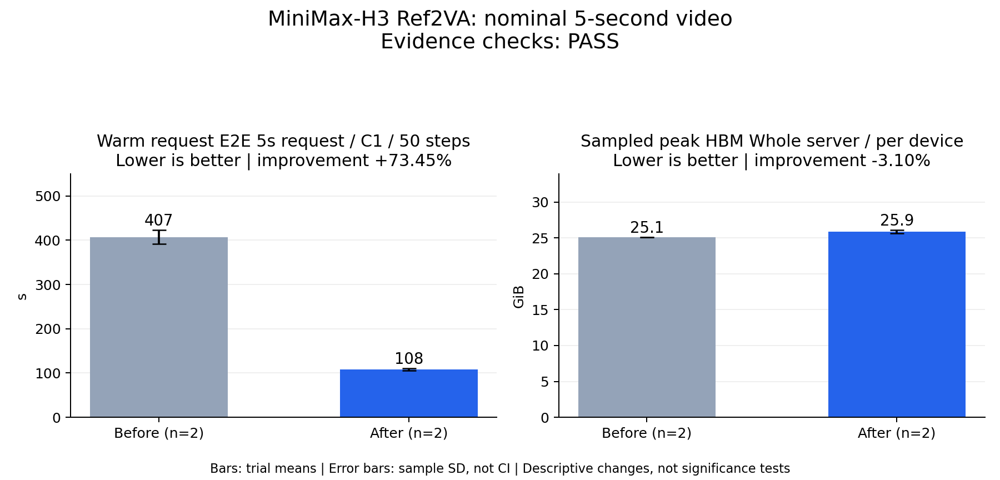

# Qualified 5-second Ref2VA result

**PASS for the frozen 5-second workload and adopted media gates.** 15-second qualification is deferred by the requester. This is the fastest passing configuration tested in this bounded search, not a global optimum.



| Independent server | Configuration | Mean HTTP E2E (s) |
| --- | --- | ---: |
| A1 | Dense baseline | 396.299 |
| B1 | Selected Cache-DiT | 106.659 |
| B2 | Selected Cache-DiT | 109.580 |
| A2 | Dense baseline | 418.238 |

Equal weighting of the two independent server means gives **407.269 ± 15.514 s → 108.120 ± 2.065 s**, a **73.452% latency reduction** and **3.767× inverse-latency speedup**. Errors are sample SD across two servers, not confidence intervals. Each server completed two warmups and three measured requests; all samples were retained. No p95/p99, throughput, or statistical-significance claim is made. See [raw measurements](measurements.json), [generated report](report.md), and [acceptance](acceptance.json).

One exclusive `npu run` reservation covered A1/B1/B2/A2 on the same eight Ascend 910B1 64-GiB devices. CPU quality scoring ran between server groups, not during performance timing. The HTTP timer covers POST through the complete MP4 response, including upload, generation, server encoding and response transfer; startup, warmups, local file writes/probing, scoring and shutdown are excluded.

## Quality, memory and lifecycle

All **26 requests** were valid: 12 measured, eight warmups and six coverage requests. All **14 quality comparisons** passed: five baseline-repeat checks, six candidate performance outputs and three candidate coverage outputs. Coverage was predefined: original reference seeds 1/2 and a different family reference at seed 0. [Quality index](quality-index.json), [ranges](candidate-quality-ranges.json), [coverage gate](coverage-gate.json), [request counts](request-counts.json).

| Metric over nine candidate outputs | Observed range | Frozen gate |
| --- | --- | --- |
| Video SSIM | 0.975969–0.984037 | ≥ 0.97 |
| Video PSNR | 38.621703–43.795689 dB | ≥ 34 dB |
| LPIPS | 0.018710–0.025843 | ≤ 0.20 |
| Audio spectral cosine | 0.813411–0.987086 | ≥ 0.80 |
| Audio RMS ratio | 0.692242–1.093770 | 0.5–2.0 |

This is lossy caching. The family case has audio cosine **0.813411** and RMS ratio **0.692242**, close to the cosine gate. These decoded-media comparisons do not certify semantic correctness, lip synchronization or ASR quality. Exact metadata, finite values and decoded PCM length checks also passed. Both arms emitted 124 frames at 1344×768/24 fps (5.167 s) and 165888 stereo samples/channel at 32 kHz (5.184 s), despite the nominal five-second request.

Mean sampled whole-server per-device peak HBM increased **25.085 → 25.863 GiB (+3.10%)**; maximum candidate observation was 26.025 GiB. Polling was nominally every ten seconds over startup, warmup, inference, coverage and teardown; this is not request-only allocator peak. [Resource observations](resource-observations.json).

All **32 worker processes**, four servers and four containers exited zero, with no forced signals. The baseline used diagnostic matched 60-second worker / 90-second outer shutdown budgets; the candidate used those native production budgets. Thus this does not qualify unchanged baseline production teardown. Last-response-to-container-exit observations were A1 33.924 s, B1 24.108 s, B2 27.743 s, A2 38.111 s; these are descriptive combined-configuration observations, not isolated gains for individual cleanup patches.

## Source and benefit of each change

| Change | Origin | Measured benefit / scope |
| --- | --- | --- |
| Selected Cache-DiT MC8/R0.48 profile | Existing [vLLM-Omni #5853](https://github.com/vllm-project/vllm-omni/pull/5853); campaign-authored bounded parameter search | Final repeated E2E result above. Existing upstream implementation, not a new kernel. |
| Optional device-resident reference KV | Existing [#8072](https://github.com/vllm-project/vllm-omni/pull/8072); campaign transfer counters and implementation | Separate interval-2 pilot: 593.240 → 327.127 s, 44.858% lower; one measured pair, quality/lifecycle pass. Not enabled in the final Cache-DiT profile; gains cannot be added. |
| Terminal DLO discard | Existing terminal AllGather handling plus campaign teardown stacks | Avoids reconstructing weights on disposal; ordinary disable/rollback still restore them. 116 CPU tests. No inference gain claimed. |
| NPU 60-second worker / 90-second outer shutdown budgets | CANN shutdown stacks and reproduced outer-deadline failure | Final native candidate clean exits; 86 executor and 10 engine shutdown/output tests at their change revisions. No inference gain claimed. |
| Explicit request-owned cache summaries | Existing H3 quality policy and reproduced missing-summary regression | 70 focused summary/payload tests; observability only. Summaries disabled for timing. |
| Matched warmups and execution deadline recipe | Cold decode observations and retained 600-second RPC failures | Reproducibility and completion, no latency gain attributed to deadline changes. |

The optional KV pilot held a subsequently rejected audio-owner implementation constant across its arms. It is separate evidence, not qualification of the final combined revision. [KV receipt](../kv-residency-pilot.json). The audio-owner change was reverted after a warmed pilot was **1.23% slower**, despite passing quality. [Selection receipt](../audio-owner-selection.json). [Cache search](../cache-range-selection.json) retains all candidates; the 1.3% gap between the top two search means is not a significance claim. The interrupted first final campaign is retained separately and contributes no samples to this replacement campaign.

## Frozen environment and reproduction

Baseline `c7f56f0155953c7d4a77276a2f4fcbd844ab0da2`; measured candidate `098b51f6b96dd160a0959e74e8822422527ff06d`. Later PR changes are documentation only. Native BF16 Ref2VA, USP8/ring1, text TP8, VAE tile8, DLO, dense `FLASH_ATTN`, 50 actual steps, seed 0, C1, flow shifts 12/3. Optional reference-KV residency is not enabled.

Container `quay.io/ascend/vllm-omni:nightly-20261022-6b35bca`, immutable ID `sha256:7fc6c73bd19a6ef4ee8d6048009972234796a1fc1bd3067168a425343cc476f7`; torch 2.10.0+cpu, torch-npu 2.10.0.post4, vLLM 0.32.0+empty, MindIE-SD 3.1.0, diffusers 0.40.0, transformers 5.19.0, cache-dit 1.5.0, CANN 9.1.0. [Input hashes](../../plan/inputs.json), [model hashes](../../plan/model-files.json), [candidate profile](candidate-profile.json).

Use the [engine recipe](https://github.com/vllm-project/vllm-omni/blob/amy/h3-ref2va-npu-opt/recipes/MiniMaxAI/MiniMax-H3-NPU.md) server command, reserve eight devices with `npu run`, and run the portable client from the evidence bundle:

```bash
python plan/run_client.py --base-url "http://127.0.0.1:${PORT}" \
  --prompt "$PROMPT" --video "$REFERENCE_VIDEO" --audio "$REFERENCE_AUDIO" \
  --output "$OUTPUT" --seconds 5 --steps 50 --seeds 0 \
  --warmups 2 --repeats 3 --quality server-default --timeout 14400
```

`server-default` omits request quality so the custom startup cache profile survives; explicit `high` or `lossless` can override it. For baseline omit startup cache arguments and use `--quality lossless`. Use fresh servers in A/B/B/A order and unique output directories. Client/execution RPC timeout is 14400 seconds; server video sync timeout is 30000 seconds; initialization timeouts are 1800 seconds. Portable coverage and quality scripts are in `plan/run_heldout.py` and `validator/compare.py`; inspect their `--help` and frozen plans. Raw media, weights and host logs remain external; public sanitized receipts and their hashes are provided. The portable scripts alone do not supply those external assets.

15-second requests, higher concurrency, other hardware and broader semantic quality remain unqualified. No 15-second performance estimate is extrapolated from this result.
