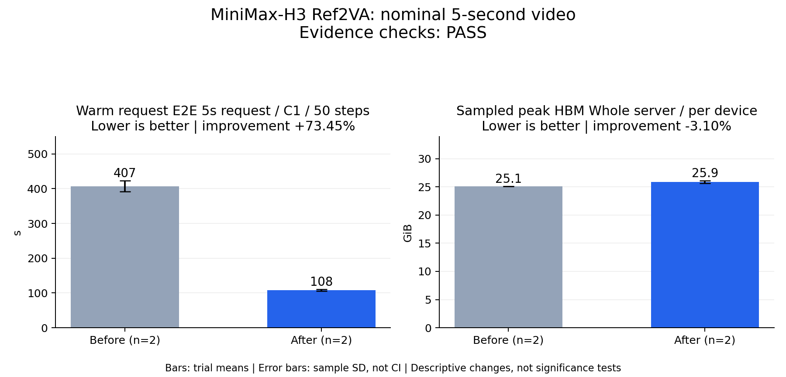

# MiniMax-H3 Ref2VA: nominal 5-second video

Evidence checks: **PASS**

PASS means supplied evidence checks passed; it does not establish a statistically significant gain.
Means are equally weighted trial means. SD is sample standard deviation, not a confidence interval.

| Metric / scenario | Direction | Before mean ± SD (n) | After mean ± SD (n) | Improvement | Scope |
|---|---|---:|---:|---:|---|
| Warm request E2E / 5s request / C1 / 50 steps (s) | lower | 407.269 ± 15.5136 (n=2) | 108.12 ± 2.06525 (n=2) | +73.45% | repeated trials |
| Sampled peak HBM / Whole server / per device (GiB) | lower | 25.085 ± 0 (n=2) | 25.8628 ± 0.229948 (n=2) | -3.10% | repeated trials |



## Input and provenance

```json
{
  "title": "MiniMax-H3 Ref2VA: nominal 5-second video",
  "synthetic": false,
  "context": {
    "hardware": "8 x Ascend 910B1, 64 GiB/card; physical cards 0..7 in one npu run reservation",
    "model": "Native MiniMax-H3 Ref2VA, BF16 weights, frozen 81-file checkpoint manifest",
    "workload": "C1, 1344x768, 24 fps, 124 decoded frames, 50 steps, seed 0; flow shifts 12/3",
    "timing_scope": "Client HTTP POST to complete MP4 response; excludes startup, two full warmups per server, file writing, evaluation and teardown",
    "baseline_revision": "c7f56f0155953c7d4a77276a2f4fcbd844ab0da2",
    "candidate_revision": "098b51f6b96dd160a0959e74e8822422527ff06d",
    "source_logs": "a1.json, b1.json, b2.json, a2.json retain samples and original service-log hashes; raw logs remain external"
  },
  "checks": {
    "comparable": "pass",
    "correctness": "pass",
    "lifecycle": "pass"
  },
  "runs": {
    "before": {
      "completed": 6,
      "failed": 0
    },
    "after": {
      "completed": 6,
      "failed": 0
    }
  },
  "notes": [
    "Order A1/B1/B2/A2; three measured requests per server, two independent server means per arm.",
    "Error bars are sample standard deviations across the two server means, not across six independent requests; no tail-latency or significance claim.",
    "All 26 requests completed: 12 performance, 8 warmup, 6 coverage. Three coverage pairs passed before B2/A2; all 14 final parity comparisons passed.",
    "All 32 workers exited zero, with no forced signals; all four servers and containers exited zero.",
    "Baseline uses diagnostic matched 60-second worker grace and 90-second outer join; candidate uses native defaults. This does not qualify original baseline production shutdown.",
    "Lossy Cache-DiT MC8/R0.48. Family coverage audio cosine 0.813411 is close to the 0.80 gate; RMS ratio 0.692242. Decoded-media parity is not semantic quality certification.",
    "HBM is the sampled maximum on any device over the complete server lifecycle, including startup and coverage; it is not an allocator-only request peak. Caching increases measured memory use.",
    "Fifteen-second qualification is deferred. The interrupted first final attempt is excluded and retained separately."
  ],
  "metrics": [
    {
      "name": "Warm request E2E",
      "scenario": "5s request / C1 / 50 steps",
      "unit": "s",
      "direction": "lower",
      "before": [
        396.29886609564227,
        418.23845322492224
      ],
      "after": [
        106.65938387345523,
        109.58008875263234
      ]
    },
    {
      "name": "Sampled peak HBM",
      "scenario": "Whole server / per device",
      "unit": "GiB",
      "direction": "lower",
      "before": [
        25.0849609375,
        25.0849609375
      ],
      "after": [
        25.7001953125,
        26.025390625
      ]
    }
  ]
}
```
