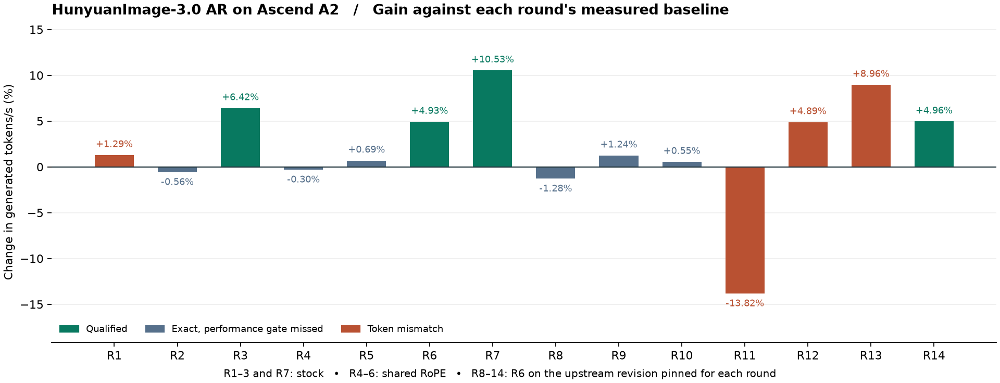

# R14: Return HunyuanImage-3.0 expert assignments from the custom router

The candidate moves the same FP32 softmax, top-k selection, and weight normalization into FusedMoE's existing router callback. It retains rounding of combine weights to the activation dtype and removes the packed float transport for weights and expert IDs. The directly compared baseline is R6 rebased onto Omni `35a84d83987a68253c4be747bf693878c6b187db`. The measured baseline is `40211d4e7b0ec7de24eb847643589a1ad891ac82`, the candidate is `ae4427277f822d7b9dd7ba77fc981f816cbff80c`, and InferRSI is `5d6f1f40aa3fe96170faf6afa92ac41ad99d3c0a`.

The batch-eight, four-card pure AR throughput changed from **42.87 to 44.99 generated tokens/s (+4.96%)**. The three pair gains were +2.44%, +1.85%, +5.98%. Baseline peak-to-peak spread was 3.23%. Full-output token parity: True. The candidate **qualified** under the recorded gates.

| Pair | Order | R6 (tokens/s) | Candidate (tokens/s) | Gain |
|---|---|---:|---:|---:|
| 1 | A/B | 42.79 | 43.84 | +2.44% |
| 2 | B/A | 44.18 | 44.99 | +1.85% |
| 3 | A/B | 42.87 | 45.43 | +5.98% |

Weights and expert IDs matched byte-for-byte for 108 operator inputs on CPU and 108 on one reserved Ascend device. Two independent baseline calibrations and six measured engines ran the frozen batch and held-out prompt. The run uses the 2,048-token scheduling budget and disables prefix caching. R7 remains the last direct measurement of the optimized stack against stock; these paired percentages have different references.

[Round ledger](round.json) · [Trial receipts and InferRSI evaluation](receipts.json) · [Protocol](protocol.txt) · [Measured patch](candidate.patch)
