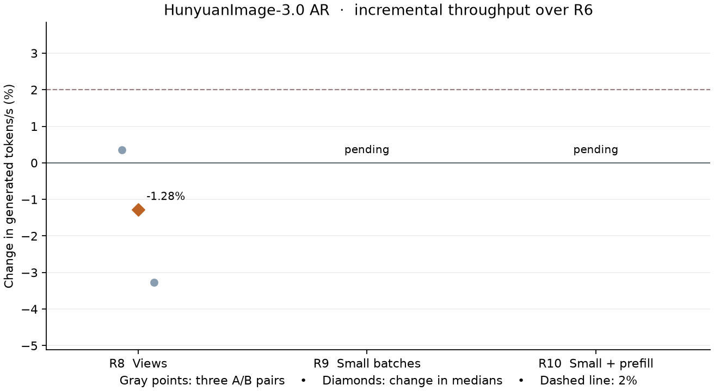

# Fused packed rotary on Ascend A2

The pinned R6 implementation is `6ed6beffdadfd616a5350420231605d145560270` on vLLM-Omni `495b5f12`. InferRSI is `01333d70`. R9 combines half-head rotation and contiguous Q/K output writes in one NPU launch for up to 16 rows. R10 tests the larger prefill shapes as well. Both candidates retain the two BF16 product roundings. Results are matched to the R6 stage at TP4, batch eight, 32 greedy tokens per request. The validators exercise fallback layouts and assert that the actual fused path ran.

| Round | Coverage | Baseline | Candidate | Median gain | Three pairs | Token-exact | Decision |
|---|---|---:|---:|---:|---|---|---|
| R9 | decode | — | — | — | — | — | pending |
| R10 | alltokens | — | — | — | — | — | pending |

[Protocol](protocol.txt) · [Per-round data](rounds.json) · [Prior total and incremental measurements](../rope-total/README.md)
