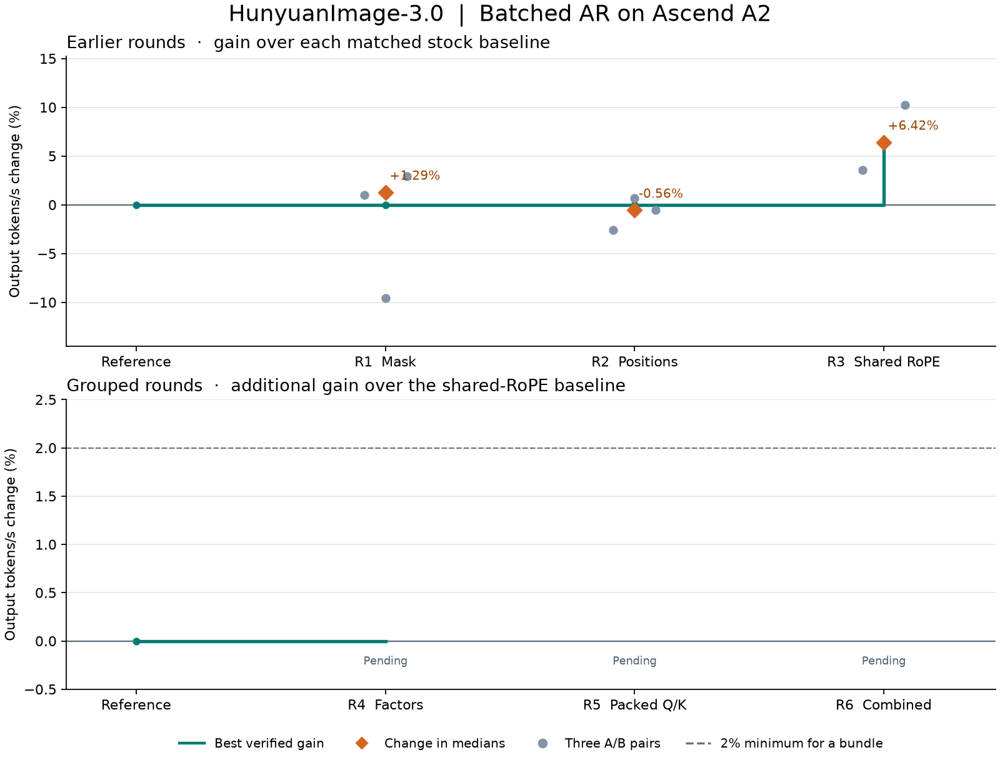

# Grouped optimizations on top of shared RoPE

Three candidate bundles target HunyuanImage-3.0-Instruct text-only AR. The common reference contains Omni draft [#11295](https://github.com/vllm-project/vllm-omni/pull/11295) on top of upstream `fe018b98`. The upstream change since the preceding campaign touches a diffusion test only. Each bundle is a complete patch relative to that reference. R4 hoists common dtype conversions and computes the trigonometric functions on the unique half of the factor tensor. R5 rotates the Q/K projection prefix together and reuses sine factors with the required sign. R6 combines them.

The InferRSI external-command runner times one frozen patch per invocation. A threshold of 2% applies to the measured bundle. Only correctness is tested separately below the bundle level. The primary metric is generated tokens/s over the entire warmed offline AR request, with four Ascend 910B1 NPUs, TP4, fixed admission of eight requests and 32 tokens per request. The same mixed CANN deployment and BF16 greedy protocol as the preceding campaign are used. Each comparison has three fresh A/B pairs in A/B, B/A, A/B order. Each process runs two warmups, three measured batches and one held-out request. A qualified gain requires exact tokens against the fresh A/A calibration, exact operator bytes, verified source, a successful evaluator verdict, three positive pairs, and a median change of at least 2% exceeding baseline peak-to-peak variability. Percentages below are all relative to shared RoPE.

| Round | Bundle | Baseline tokens/s | Candidate tokens/s | Median change | Paired changes | Exact | Qualified |
|---|---|---:|---:|---:|---|---|---|
| R4 | factors | — | — | — | — | — | pending |
| R5 | packed | — | — | — | — | — | pending |
| R6 | combined | — | — | — | — | — | pending |

[JSON ledger](rounds.json) · [Frozen protocol](protocol.txt) · [Earlier rounds](../lossless/README.md)
