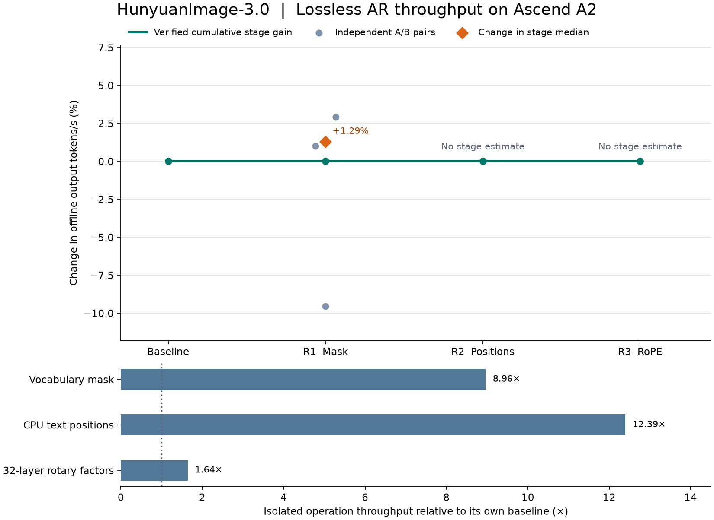

# Lossless AR optimization rounds

Track the HunyuanImage-3.0-Instruct text-only AR stage on Ascend 910B1. Each new candidate is compared independently with upstream vLLM-Omni `dda822f4a7e1839b34abc09a2cbb4dbee07ee7eb`. The InferRSI harness is pinned to `f74f1d02d99782031579e629b56d5d132e7f56a8`. The first round is the earlier mask experiment.

| Round | Operation | Baseline | Candidate | Isolated speedup |
|---|---|---:|---:|---:|
| 1 | Generation-vocabulary mask on one A2 device | 44,290 rows/s | 396,763 rows/s | 8.96× |
| 2 | CPU text mRoPE position construction | 1,516 prompts/s | 18,796 prompts/s | 12.39× |
| 3 | Rotary embedding across 32 layers on one A2 device | 30,237 token rows/s | 49,600 token rows/s | 1.64× |

The CPU candidate constructs the three identical text position axes from a single integer range. The existing image-block traversal handles prompts containing a beginning-of-image token. The rotary candidate computes the original interleaved FP32 cosines and sines once per forward and passes them to local layers. It preserves the cast to the query dtype and the order of rotation arithmetic. No table is retained across requests.

Two separate InferRSI runs each include three alternating pairs for the new components. Thirty-six CPU cases check positions, offsets, dtype and strides. The rotary checks compare Q and K byte-for-byte for six token counts, three coordinate layouts and three dtypes. Additional checks use strided Q/K views from a packed TP4 projection. Each JSON receipt lists all six trials and timestamps. Candidate patches, public validators and the deploy file are under this directory.

The primary metric is warm offline output tokens/s for batch eight with 32 greedy tokens per request. A complete phase includes two warmups and three timed batches in each of six independent engines. Exact token IDs must match on all eight prompts and an untimed held-out prompt. A qualified gain must exceed both 1% and the baseline peak-to-peak spread divided by its median, with a positive gain in all three pairs and verified source snapshots. The green curve carries the best candidate that clears all gates. Percentages from independent candidates are never compounded. A missing full-stage result is left blank in the ledger.

## Reproducibility

Use the standard `inferrsi run` external-command harness for each arm. The two candidate diffs apply independently to the pinned baseline. The isolated validator runs as `python validator/exact_ops.py positions BASELINE CANDIDATE OUT` or with `rope` on an allocated NPU. Each isolated trial runs `python validator/time_op.py OP CHECKOUT SIDE OUT`. The complete model uses `Omni.generate` at TP4, prefix caching disabled, eager execution and bf16 weights. The ordinary greedy reference produced different sequences on repeat. A diagnostic variant uses the engine's pause/resume RPC to queue the entire batch before allowing stage 0 to begin. Its timing includes these RPCs. Held-out prompts run after timing.

[Acceptance issue](https://github.com/InferMatrixLab/InferRSI/issues/775)
