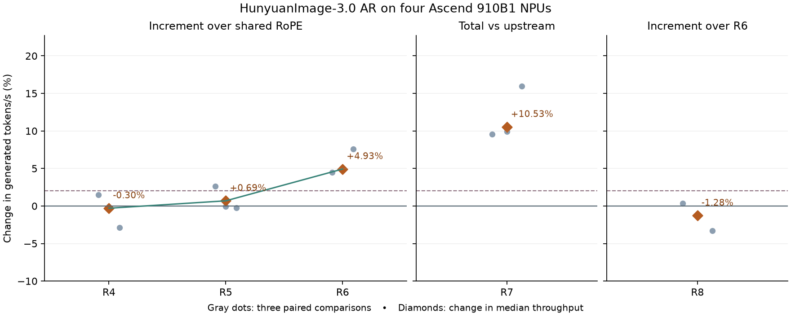

# Total AR throughput and the next bundled candidate

Upstream Omni `495b5f12`, InferRSI `01333d70`. R7 compares stock directly with all qualified changes through R6. R8 compares two additional changes against R6 on the same revision: yield shared-storage Q/K views where Q/K normalization consumes them immediately and cross-layer attention is disabled, and fetch the prepared typed factors directly in the hot path. All original arithmetic and checkpoint weights are preserved.

| Round | Matched reference | Baseline output tokens/s | Candidate output tokens/s | Median gain | Three pairs | Exact | Decision |
|---|---|---:|---:|---:|---|---|---|
| R7 | Full stack vs upstream | 40.01 | 44.22 | +10.53% | +9.57%, +9.90%, +15.97% | True | qualified |
| R8 | Views + dispatch vs R6 | 44.36 | 43.79 | -1.28% | +0.35%, -1.32%, -3.27% | True | measured |

[Earlier rounds](../lossless/README.md) · [R4–R6](../grouped-rope/README.md) · [Per-round snapshots](snapshots/) · [Raw ledger](rounds.json) · [Protocol](protocol.txt)
