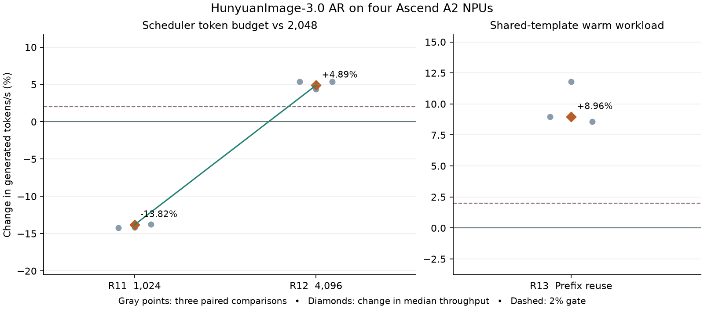

# Scheduling budgets and shared-prefix reuse on Ascend A2

R11 and R12 explore the chunked-prefill tradeoff discussed in [Sarathi-Serve](https://arxiv.org/abs/2403.02310) and [SGLang's tuning guide](https://github.com/sgl-project/sglang/blob/main/docs/docs/advanced_features/hyperparameter_tuning.mdx). The vLLM scheduler spends its budget across the whole step, including decode. The candidates change the existing vLLM deployment parameter; see [vLLM's tuning guide](https://docs.vllm.ai/en/latest/configuration/optimization/).

R13 is inspired by [SGLang RadixAttention](https://arxiv.org/abs/2312.07104). It tests vLLM prefix caching at a fixed 2,048-token budget. Both arms prime only the shared template, outside the primary timer, through an additional one-token request before each batch. Each group uses a new salt to prevent whole-prompt replay. Receipts retain actual cached tokens and throughput including priming.

Omni upstream `f171117291cd40e2d5f877069520cdb8583deb26` plus the R6 implementation; InferRSI `01333d70e3c8b33f940b844b8569d96b39388a83`. Same stage, weights, TP4, BF16, fixed batch of eight, and 32 greedy output tokens. Every setting is a separate head-to-head trial against its matched reference. Acceptance requires source integrity, the intended settings, exact tokens and all three gains above zero; the median improvement must be at least 2% and exceed baseline spread. All rates are generated tokens/s.

| Round | Setting | Matched baseline | Candidate | Median change | Three paired changes | Exact | Qualified |
|---|---|---:|---:|---:|---|---|---|
| R11 | budget1024 | 44.80 | 38.61 | -13.82% | -14.24%, -14.15%, -13.72% | False | False |
| R12 | budget4096 | 44.19 | 46.35 | +4.89% | +5.36%, +4.40%, +5.38% | False | False |
| R13 | prefix | 44.17 | 48.12 | +8.96% | +8.96%, +11.80%, +8.60% | False | False |

The eight measured prompts are 1,238–1,243 tokens long, with 9,927 input tokens in the batch. A 1,024-token step budget is smaller than one full prompt. At 2,048 and 4,096 a single step can accommodate different numbers of prompts. The scheduler shares this budget with active decode requests.

The shared prefix contained 1227 tokens. Cache-on hit range per measured request: [1152, 1152]. Counting the extra priming request's time in both arms gives 42.61 → 45.96 generated tokens/s (256 user-visible output tokens per batch).

Each arm produced 120 batch sequences and three independently submitted held-out sequences per round. Exact matches against the independent reference:
- R11 reference 120/120 and 3/3 held-outs; candidate 90/120 and 3/3 held-outs.
- R12 reference 120/120 and 3/3 held-outs; candidate 90/120 and 3/3 held-outs.
- R13 reference 120/120 and 3/3 held-outs; candidate 75/120 and 3/3 held-outs.

[Protocol](protocol.txt) · [Ledger](rounds.json) · [Prior kernel rounds](../fused-rotary/README.md)
