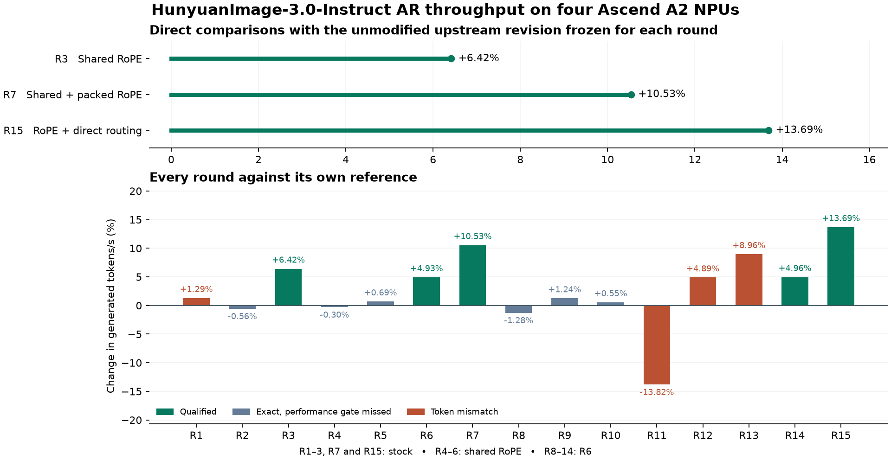

# R15: complete optimized AR stack versus unmodified upstream

On four Ascend 910B1 devices, the same batch-eight HunyuanImage-3.0-Instruct offline text AR workload produced **39.94 → 45.40 generated tokens/s (+13.69% change in medians)**. The median of the three paired percentage changes is **+13.43%**. Baseline peak-to-peak spread is 13.26%. Generated token sequences were exact: True. Campaign qualification: True.

The unmodified baseline is vLLM-Omni `0b6b40d0f9b282a2007cf12eb88c62e09a9c68fa`. The candidate is `ca6458cdc5b89e192c544b0e8088fea5c5e16b9d` on the same revision, using the unique commits from [#11295](https://github.com/vllm-project/vllm-omni/pull/11295), [#11309](https://github.com/vllm-project/vllm-omni/pull/11309) and [#11328](https://github.com/vllm-project/vllm-omni/pull/11328). InferRSI is pinned to `7e25f449215e76fde51f2d037b9134a6aea81976`. The exact PR heads are in [the ledger](round.json).

| Pair | Order | Unmodified (tokens/s) | Complete stack (tokens/s) | Change |
|---|---|---:|---:|---:|
| 1 | A/B | 39.94 | 45.30 | +13.43% |
| 2 | B/A | 35.46 | 46.03 | +29.79% |
| 3 | A/B | 40.76 | 45.40 | +11.40% |

Two fresh unmodified-engine calibrations preceded the six paired engines. Each ran two warmup batches, three timed batches and a separate held-out request. The validator checked 30/30 complete batches and 6/6 held-out sequences against the calibration. The timed boundary includes prefill and decode of the AR stage. Diffusion, VAE and engine startup are outside this throughput measurement. Each prompt generates 32 greedy tokens, with BF16 eager execution, a 2,048-token scheduler budget and prefix caching disabled.

[Protocol](protocol.txt) · [Pair and token receipts](receipts.json) · [Prior incremental R14 measurement](../direct-moe-routing/README.md)
