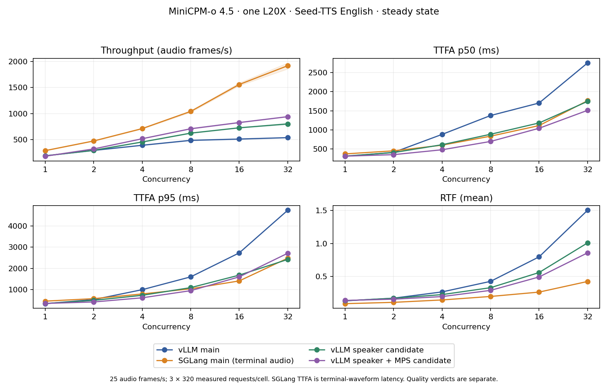
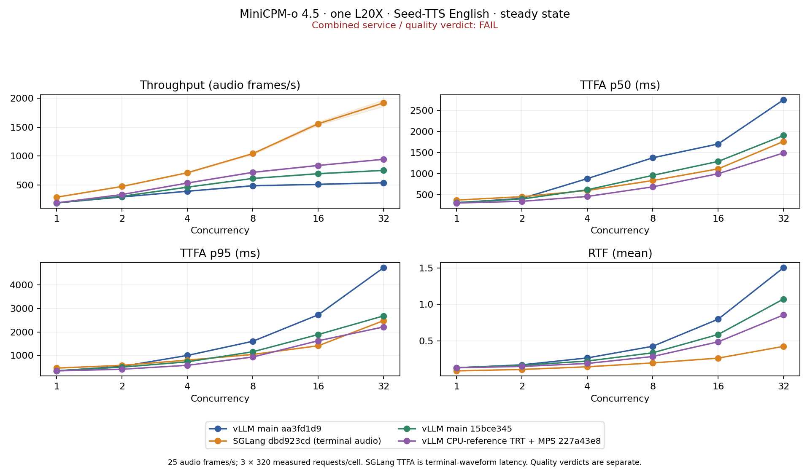

# MiniCPM-o 4.5: single-L20X throughput study

## Round two: active, INCONCLUSIVE

The requester asked to continue until vLLM-Omni exceeds the source-pinned single-GPU peer at C16 and C32 while retaining the authorized quality margins. This goal is **not achieved**. The earlier failed campaign remains documented below.

- [Frozen continuation plan and unused256-prompt cohort](plan/peer-round2.json), [current status](results/peer-round2-status.json), and [acceptance issue](https://github.com/InferMatrixLab/InferRSI/issues/49).
- [Peer repeated baseline](results/peer-round2-baseline.json): exploratory mean C16/C32 throughput1698.4/2532.2 frames/s; final candidate confirmation still requires equivalent repeated comparison. The fast peer profile is not the speech-quality reference.
- [Screening speech quality](results/peer-round2-screen-quality.json), [FP16 dispatch correction](results/peer-round2-dispatch-screen.json), and [FP32 batch-width screen](results/peer-round2-batch16-screen.json). Reused64-prompt screens do not establish final acceptance.
- [Rejected prompt-setup numerical result](results/peer-round2-setup-numerical.json), [HiFT precision screen](results/peer-round2-screen-hift-tf32-mps.json), and [FP16 residency screen](results/peer-round2-screen-fp16-resident16-mps.json).
- [Independent operator profile](results/peer-round2-stage2-profile.json) motivates the [completed graph-coverage trials](results/peer-round2-graph-screens.json). Profiled requests are excluded from performance aggregates.
- [Selective CFM precision screen](results/peer-round2-cfm-only-fp16-screen.json): C16/C32 815.5/864.3 frames/s; descriptive quality means within margins, no confidence-bound acceptance.
- [Two same-GPU replicas](results/peer-round2-replicas2-screen.json): C16/C32 973.1/1057.4 frames/s; descriptive quality means within margins. [Native Talker plus two replicas](results/peer-round2-native-talker-replicas2-screen.json): 1053.7/1172.1 frames/s, but C32 SIM mean drops1.76, exceeding the0.50 margin. Neither is a qualified peer win.
- [Native stage2 control](results/peer-round2-native-stage2-screen.json) reaches C32 898.2 frames/s. The [coalescing contrast](results/peer-round2-native-coalescing-screen.json) initially failed startup; its constructor fix passes104 scheduler tests. The successful retry reaches C16/C32 773.9/904.8, with no material throughput gain.
- [Prompt-setup A/A audit](results/peer-round2-setup-control-audit.json) confirms the numerical rejection; the [four-replica scaling diagnostic](results/peer-round2-native-talker-replicas4-screen.json) reaches C32 1332.4, but C32 WER increases1.4144 percentage points in the descriptive screen, exceeding the0.20 margin.
- [Exact Torch speaker graph](results/peer-round2-speaker-graph-wrapper-probe.json): four real references are bitwise equal; component latency falls from about11.4 to4.9ms. Output ownership, shape capacity, policy fallback, and backend integration checks pass. [Service and composition trials](plan/peer-round2-cfm-speaker-composition.json) remain unqualified.
- [Matched peer tuning workload](results/peer-round2-peer-tuning64.json) reaches C16/C32 1493.4/2544.1 frames/s on the same64 prompt IDs; the unchanged320-request repeated baseline remains the formal target.
- [Ordinary Talker2 / Code2Wav4 FP32](results/peer-round2-pipeline-replicas-screen.json) reaches C16/C32 1103.9/1423.5 frames/s; [selective CFM FP16 composition](results/peer-round2-cfm-speaker-screen.json) reaches1184.3/1510.9. Both have descriptive means within margins, without confidence-bound qualification.
- [50-frame window screen](results/peer-round2-window50-screen.json) reaches1316.0/1592.2 frames/s, below the matched peer. C32 TTFA p50/p95 is1.517/1.973s and the first audio chunk averages1.84s. Quality scoring is pending. Larger windows affect first-audio latency and numerical context; this is not equivalent-latency streaming.
- [Three-repeat quality design](plan/peer-round2-quality-repeats.json) was frozen before generating any reserved holdout output. The256 paired prompt clusters remain the independent units: sum WER counts and average SIM/UTMOS within each prompt across three fixed-seed runs, then apply unchanged20,000-draw bootstrap and all9 margins. [Validator controls](validator/test_peer_round2_clustered_quality.py) pass8 synthetic cases; this is not a real quality verdict. Earlier FAILs remain unchanged.
- [Separate CPU/GIL diagnostic](plan/peer-round2-pipeline-cpu-profile.json) is excluded from performance reporting and will guide the next implementation hypothesis.
- [Reproducible exploratory implementation patches](patch/peer-round2-manifest.json); none is presented as a qualified peer-beating release.


Acceptance: [InferRSI #49](https://github.com/InferMatrixLab/InferRSI/issues/49).

**Original strict quality verdict: FAIL** for both completed historical speaker-only and speaker+MPS candidates. The separately authorized noninferiority evaluation on previously unused prompts also **FAILS** on C16/C32 WER. The adapted revision also FAILS its separately scoped regression against updated main (C16 WER, C32 WER/SIM). No later comparison changes the earlier verdicts. Component PASS does not establish service PASS.

## Scope and controls

- One NVIDIA L20X (143771 MiB) per serving engine; shared host, reserved GPUs. vLLM baseline and speaker candidate use the same physical GPU. Other comparisons use the same GPU SKU.
- Official model revision and all asset hashes: `plan/official-model-manifest.json`. The initially discovered local checkpoint had different metadata and was excluded.
- Current main revisions are frozen in `plan/baseline-plan.json`. Main means those fetched snapshots, not a moving branch.
- Seed-TTS English voice cloning: disjoint warmup, tuning and evaluation pools; source metadata and reference WAV hashes are frozen.
- Concurrency 1, 2, 4, 8, 16, 32. Each baseline cell has 320 requests per repeat, one discarded run, then three measured repeats. Warmup uses 2 × concurrency separate rows.
- Persistent-server steady state: caches are not reset between runs/cells. `cache_policy: none` means no reset procedure, not disabled caches. This is not the peer engine strict cold-cache certification; C32 uses 320 rather than its 640 requests.
- Throughput is 25 × delivered audio seconds / measured wall time; it is an audio-frame equivalent, not video fps. The table averages three run throughputs. TTFA percentiles pool 960 requests; RTF is the mean per-request last-audio latency divided by generated duration.
- vLLM streams audio chunks. SGLang returns a terminal waveform, so its TTFA is effectively completion latency. Do not interpret the two TTFA columns as equivalent streaming capability.

The native main configurations also differ: SGLang Code2Wav uses float16, compiled DiT/HiFT, eight reference workers and a 32-entry prompt cache; the initial vLLM snapshot uses its default FP32 CFM path and serial CPU reference preparation. Updated main uses Torch CUDA speaker extraction. These are native-engine comparisons, not an isolated backend comparison with identical numerical kernels and scheduling.

## Initial main snapshots (before CUDA Torch became the vLLM default)

| Engine | C | Frames/s | TTFA p50 ms | TTFA p95 ms | RTF mean |
|---|---:|---:|---:|---:|---:|
| vllm | 1 | 192.6 | 307.5 | 343.1 | 0.132 |
| vllm | 2 | 295.5 | 410.9 | 534.6 | 0.172 |
| vllm | 4 | 394.0 | 881.6 | 1000.2 | 0.267 |
| vllm | 8 | 488.4 | 1375.3 | 1602.6 | 0.426 |
| vllm | 16 | 513.3 | 1702.7 | 2727.5 | 0.797 |
| vllm | 32 | 540.2 | 2752.3 | 4732.2 | 1.502 |
| sglang | 1 | 291.3 | 371.0 | 461.9 | 0.089 |
| sglang | 2 | 476.6 | 451.3 | 578.7 | 0.109 |
| sglang | 4 | 713.8 | 599.6 | 799.9 | 0.145 |
| sglang | 8 | 1043.2 | 835.1 | 1042.6 | 0.198 |
| sglang | 16 | 1558.5 | 1112.0 | 1411.5 | 0.264 |
| sglang | 32 | 1918.5 | 1763.5 | 2479.4 | 0.425 |

All 11,520 measured baseline requests completed successfully. Raw per-request metrics, individual run variation and WAV hashes are in `results/*-main-repeated.json.gz`. Generated WAVs, wire payloads and unredacted server logs remain local.

## Reproduction

Set paths explicitly; do not point the benchmark at an unrelated running service. Use separate compatible environments for the two engines, matching the package manifests under `plan/`.

```bash
export MODEL=/absolute/path/to/pinned-official-model
export PEER=/absolute/path/to/minicpm-o-4.5-single-gpu-engine
export SEED_TTS_ROOT=/absolute/path/to/seed-tts-eval
export EVIDENCE=/absolute/path/to/this/evidence/directory
export RUNS=/absolute/path/to/output-directory
export VLLM_OMNI=/absolute/path/to/vllm-omni
export SGLANG_OMNI=/absolute/path/to/sglang-omni
```

The peer benchmark revision is recorded in `validator/benchmark-sources.json`; do not silently substitute a newer client. The driver uses explicit adapter sampling and prompt settings from that snapshot.

Baseline vLLM server (activate its environment first, reserve one GPU):

```bash
python -m vllm_omni.entrypoints.cli.main serve "$MODEL" --omni \
  --served-model-name openbmb/MiniCPM-o-4_5 --host 127.0.0.1 --port 29161 \
  --deploy-config "$VLLM_OMNI/vllm_omni/deploy/minicpmo_4_5_turn.yaml" \
  --trust-remote-code --init-timeout 1800 --stage-init-timeout 1800
```

Baseline SGLang server (activate its environment first, reserve one GPU; use unused distributed ports and a writable private endpoint directory):

```bash
python -m sglang_omni.cli serve --model-path "$MODEL" --model-name minicpmo \
  --thinker.engine.mem_fraction_static .55 --talker.engine.mem_fraction_static .15 \
  --thinker.engine.dist_init_addr 127.0.0.1:29671 \
  --talker.engine.dist_init_addr 127.0.0.1:29672 \
  --thinker.factory.max_seq_len 8192 --endpoints.base_path "$RUNS/endpoints" \
  --host 127.0.0.1 --port 29171
```

After readiness, run the matched benchmark client:

```bash
PYTHONPATH="$PEER" python "$EVIDENCE/validator/run_baseline.py" \
  --adapter vllm-omni --url http://127.0.0.1:29161 \
  --out "$RUNS/vllm-main" --concurrency 1 2 4 8 16 32 --requests 320 --repeats 3
PYTHONPATH="$PEER" python "$EVIDENCE/validator/run_baseline.py" \
  --adapter sglang-omni --url http://127.0.0.1:29171 \
  --out "$RUNS/sglang-main" --concurrency 1 2 4 8 16 32 --requests 320 --repeats 3
```

For tuning use `--id-set tuning --requests 64 --repeats 1`. Do not mix tuning rows with held-out evaluation. Original baselines used driver v1; v2 only adds tuning-pool selection, with unchanged evaluation behavior. File hashes and usage are recorded in `validator/driver-revisions.json`.

## Speaker candidate reproduction

Check out the candidate revision in `patch/candidate.json`; install the optional
TensorRT package matching CUDA (this run used `tensorrt-cu13==11.4.0.106`).
Copy `patch/speaker-only.yaml` beside `minicpmo_4_5_turn.yaml` in the vLLM-Omni
deploy directory. Start the same server with that overlay as `--deploy-config`.
Set `COSYVOICE3_TRT_CACHE` to a writable persistent directory; first startup
builds the engine. Use the identical benchmark command against the candidate
port and a separate output directory. No DiT TensorRT, quantization, cache-size
or sampling changes are part of this candidate.

## Accuracy and numerical validation

Quality uses existing SGLang-Omni scorers: Qwen3-ASR WER, WavLM speaker similarity (reported ×100), and UTMOS. Scorer weight hashes are frozen in `validator/scorer-model-hashes.json`. Score C1/C16/C32 run1 WAVs after each run has finished saving files; merely seeing `summary.json` is insufficient.

```bash
PYTHONPATH="$SGLANG_OMNI:$PEER" python "$EVIDENCE/validator/score_outputs.py" \
  --run "$RUNS/vllm-main/c32/run1" --out "$RUNS/quality-main-c32.json" \
  --scorers /absolute/path/to/scorer-assets --asr-port 29181 --device cuda:0
```

The ASR service is a separate Qwen3-ASR-1.7B SGLang-Omni server. The scorer validates nonempty finite audio and retains per-request scores. Public quality artifacts omit generated transcripts but retain WAV hashes and error counts.

Speaker numerical validation uses the checked-in `validator/bench_speaker.py`. It covers 32 tuning references plus short partial-window inputs, with 10 warmups and 30 synchronized latency samples. `speaker_trt_ieee.py` is the preserved historical precision-only diagnostic helper; the final CPU-reference path imports the candidate implementation directly.

```bash
PYTHONPATH="$PEER:$VLLM_OMNI" python "$EVIDENCE/validator/bench_speaker.py" \
  --model "$MODEL" --backend trt --cpu-reference --out "$RUNS/speaker-micro.json"
```

## Interpretation limits

The optimization target is high-concurrency throughput with no speech-quality regression, not a globally optimal configuration. English voice cloning does not establish multilingual, visual, full-duplex or interruption correctness. Historical reference-engine results are prior art, not measurements reproduced by this campaign. Profiling perturbed MRv2 execution, so its stack samples are diagnostic only and excluded from performance tables.

## Separately authorized noninferiority holdout

The original zero-regression gates are preserved. After seeing first-cohort results, the user authorized a new engineering tolerance: WER +0.20 percentage points, SIM (×100) −0.50, UTMOS −0.05. These are not published perceptual equivalence thresholds. `plan/noninferiority-holdout.json` freezes unused evaluation rows 320–639, concurrency 1/16/32, and the paired 20,000-resample prompt bootstrap. Every one-sided 95% degradation upper bound must meet its margin; missing evidence is INCONCLUSIVE. Model/profile selection uses the existing throughput cohort before opening the new holdout. No threshold adjustment or tuning is allowed after those outputs are inspected.

## Completed speaker-only service result

The three-repeat speaker-only run completed all 5,760 measured requests. The original quality gate is **FAIL**, even though high-concurrency throughput improved in every repeat. Run-level variation and all requested latency metrics are retained in `results/speaker-comparison.json`. C1 SIM/UTMOS decreased; C16/C32 WER increased. Repeated C1 scoring and waveform diagnostics are preserved rather than relabeling the differences as noise.

| C | Frames/s | TTFA p50 ms | TTFA p95 ms | RTF mean |
|---|---:|---:|---:|---:|
| 1 | 190.8 | 314.0 | 350.3 | 0.133 |
| 2 | 298.0 | 405.8 | 499.2 | 0.170 |
| 4 | 457.0 | 611.3 | 736.3 | 0.226 |
| 8 | 626.7 | 885.2 | 1096.9 | 0.331 |
| 16 | 728.9 | 1180.8 | 1683.7 | 0.560 |
| 32 | 803.4 | 1745.6 | 2421.3 | 1.008 |

## Selected speaker + MPS profile

All 5,760 measured requests completed. The profile was selected by the predeclared geometric mean of C16/C32 three-repeat throughput, before generating the new holdout. Its original strict speech verdict is also **FAIL**; use `results/mps-comparison.json` for that verdict and `results/noninferiority-holdout.json` for the separate new decision when available. Copy `patch/speaker-mps.yaml` beside the base deploy YAML to reproduce this optional profile.

| C | Frames/s | TTFA p50 ms | TTFA p95 ms | RTF mean |
|---|---:|---:|---:|---:|
| 1 | 184.1 | 312.2 | 354.1 | 0.138 |
| 2 | 323.8 | 351.7 | 423.3 | 0.157 |
| 4 | 519.3 | 479.4 | 619.0 | 0.196 |
| 8 | 710.5 | 697.1 | 954.1 | 0.290 |
| 16 | 829.4 | 1042.0 | 1602.3 | 0.493 |
| 32 | 942.3 | 1510.9 | 2712.0 | 0.858 |



Bands show the minimum/maximum run throughput, not confidence intervals. Quality qualification is separate. MPS improves high-concurrency throughput here but reduces C1 throughput; C32 TTFA p95 is worse than speaker-only even though throughput is higher.

## Reproduce the separately frozen holdout

Run `validator/holdout_pair.py --help` for explicit environment/repository paths.
It starts baseline then candidate inside a single externally reserved GPU,
uses `run_holdout.py --eval-offset 320 --requests 320 --repeats 1`, and saves a
`complete` marker only after all WAVs are written. Use the selected MPS overlay
and the model, package, scorer and source pins in this evidence tree. Do not run
another performance client against either service concurrently.

Score run1 at C1/C16/C32 for both roles with `validator/score_outputs.py`, naming
outputs `vllm-holdout-main-c{C}.json` and
`vllm-holdout-candidate-c{C}.json` in a common quality directory. Then run:

```bash
python "$EVIDENCE/validator/noninferiority.py" \
  --plan "$EVIDENCE/plan/noninferiority-holdout.json" \
  --quality-dir "$RUNS/quality" --out "$RUNS/noninferiority-holdout.json"
```

The validator checks exact frozen prompt IDs and complete scorer coverage,
recomputes corpus WER from counts in each paired resample, and reports every
metric's degradation, confidence upper bound, margin and verdict. All nine
checks must pass. This inference is conditional on the generated outputs;
it does not establish equivalence across generation seeds or replace a
listening study. A failed upper-bound gate does not by itself prove perceptual
inferiority.

Host CPUs and the filesystem are shared with other jobs; GPU reservations are
cooperative and cannot prevent unreserved processes; CPU affinity is not isolated. The host has two Intel Xeon
Platinum 8480C sockets, 112 physical cores / 224 hardware threads. Results are
scoped observations on this host, not hardware-independent performance claims.

## Restart confirmation

`results/fresh-start-confirmation.json` compares freshly started main and speaker-only services sequentially on one reserved GPU, using the original first cohort. At C16 throughput was 518.6 versus 689.4 frames/s; at C32, 546.9 versus 799.2. These single measured repeats support persistence of the throughput direction, not a new confidence interval. The C1 SIM/UTMOS decrease also persisted. The separately authorized noninferiority holdout remains a distinct experiment.

## Upstream integration during the experiment

While the frozen experiment was running, vLLM-Omni merged #9178, enabling
Torch CUDA speaker extraction by default. The historical `aa3fd1d9` baseline
and `f2462435` candidate remain intact. Their measurements must not be described
as gains over the newer `15bce34586` main snapshot.

The adapted PR revision is `227a43e898f8b96236f48f16f399431c8ad0ddcc`.
It preserves the new Torch default and exposes `token2wav_spk_cpu_reference`
as an explicit opt-in, with a checked-in MPS overlay. Use
`patch/integrated-candidate.json` and
`patch/minicpmo_4_5_cpu_reference_trt_mps.yaml` for that revision;
`patch/candidate.json` and the earlier overlays describe the historical one.

Updated-main and adapted-candidate six-cell repeats are governed by
`plan/latest-main-addendum.json` and `plan/integrated-comparison.json`.
Their quality comparison uses previously seen first-cohort prompts and is
explicitly an integration regression, not another untouched holdout. The
original unused-cohort decision remains separately scoped to the historical
candidate. Source equality checks in `validator/integration-equivalence.json`
cover the speaker implementation only; updated coordinator behavior still
requires the separate service comparison.

## Untouched-cohort noninferiority result: FAIL

The frozen historical candidate fails the authorized quality bounds. All 320 prompts are retained in each cell. Values below are degradation and its one-sided 95% upper bound; negative degradation means improvement. WER is in percentage points, SIM is on the ×100 scale.

| C | WER delta / upper (margin 0.20) | SIM drop / upper (margin 0.50) | UTMOS drop / upper (margin 0.05) | Verdict |
|---|---:|---:|---:|---|
| 1 | 0.0289 / 0.0871 | -0.0792 / -0.0196 | 0.0008 / 0.0063 | PASS |
| 16 | 0.4047 / 0.9043 | -0.1930 / 0.2013 | 0.0027 / 0.0201 | FAIL |
| 32 | 1.4166 / 4.7298 | 0.0946 / 0.49995 | 0.0246 / 0.0430 | FAIL |

At C32, a single prompt contributes 57 additional errors against a net total increase of 49. Both baseline and candidate already transcribe poorly on that prompt; the candidate C32 ASR result reproduces exactly on three resubmissions of its saved WAV. Baseline C32 resubmissions agree with each other but differ from its original ASR text by one whitespace token. These diagnostics do not delete the prompt, clip its WER, replace frozen scores, or establish a causal model defect. See `results/holdout-error-attribution.json` and `results/outlier-asr-repeat.json`.

## Final adapted revision versus updated main

Baseline `15bce34586` and candidate tree `227a43e8` completed all six cells, three measured repeats of 320 requests per cell, with zero measured request failures. PR head `172395ef` has the identical Git tree; its extra commit only refreshed CI. Both high-concurrency performance gates pass, but the combined service/quality verdict is **FAIL**.

| Engine / profile | C | Frames/s | TTFA p50 ms | TTFA p95 ms | RTF mean |
|---|---:|---:|---:|---:|---:|
| Updated main | 1 | 191.4 | 312.5 | 349.7 | 0.133 |
| Updated main | 2 | 306.8 | 396.5 | 503.1 | 0.165 |
| Updated main | 4 | 464.2 | 617.0 | 729.8 | 0.224 |
| Updated main | 8 | 614.8 | 957.6 | 1156.1 | 0.337 |
| Updated main | 16 | 696.4 | 1288.5 | 1889.4 | 0.587 |
| Updated main | 32 | 753.9 | 1904.7 | 2681.9 | 1.073 |
| CPU-reference TRT + MPS | 1 | 193.0 | 301.4 | 342.1 | 0.131 |
| CPU-reference TRT + MPS | 2 | 337.2 | 341.7 | 413.5 | 0.150 |
| CPU-reference TRT + MPS | 4 | 535.6 | 457.4 | 580.1 | 0.191 |
| CPU-reference TRT + MPS | 8 | 720.2 | 685.0 | 932.5 | 0.286 |
| CPU-reference TRT + MPS | 16 | 838.9 | 996.6 | 1624.8 | 0.487 |
| CPU-reference TRT + MPS | 32 | 945.4 | 1490.0 | 2211.1 | 0.855 |

Observed high-concurrency throughput gains versus updated main are **20.5% at C16 and 25.4% at C32**. Every candidate repeat exceeds every baseline repeat in both cells. These are combined CPU-reference TRT plus MPS observations, not isolated TensorRT attribution.

Quality uses the already-seen first cohort. The same predeclared margins and paired-bootstrap function apply, but this is an integration regression rather than another independent holdout. Table entries are degradation / one-sided 95% upper bound.

| C | WER pp (margin 0.20) | SIM ×100 drop (margin 0.50) | UTMOS drop (margin 0.05) | Verdict |
|---|---:|---:|---:|---|
| 1 | 0.0000 / 0.0577 | -0.0042 / 0.0947 | 0.0121 / 0.0213 | PASS |
| 16 | 0.4549 / 0.8451 | -0.4792 / -0.0491 | 0.0016 / 0.0181 | FAIL |
| 32 | 0.1422 / 0.2847 | 0.3191 / 0.6818 | 0.0152 / 0.0311 | FAIL |

C16 WER fails. At C32, WER and SIM point estimates are inside their margins, but their upper confidence bounds fail; this does not establish population or perceptual inferiority. No prompts or original scores are excluded. The earlier untouched-cohort FAIL remains unchanged.



Observed throughput ranges are repeat ranges, not confidence intervals. SGLang TTFA measures terminal-waveform delivery. Native precision and scheduling differ; neither the figure nor the throughput gains establish speech-quality equivalence or a global optimum.

Machine-readable metrics for all four pinned engine/profile snapshots: [concurrency-metrics.csv](results/concurrency-metrics.csv).

## Final same-GPU attribution controls

Fresh services ran sequentially on the same reserved L20X: updated main, CPU-reference TRT + MPS, then unchanged updated main with only MPS enabled. Each C16/C32 cell has one discarded and one measured 320-request run. These reused-cohort, single ordered repeats are descriptive controls, not independent speech-quality qualification or an ABBA study.

| C | Main frames/s | CPU-ref TRT + MPS frames/s | Torch + MPS frames/s | CPU-ref / Torch+MPS |
|---|---:|---:|---:|---:|
| 16 | 693.1 | 815.6 | 783.3 | 1.041× |
| 32 | 766.1 | 929.4 | 864.3 | 1.075× |

Quality means below describe these control WAVs. They do not replace either frozen validation result. WER is corpus WER (%); SIM is ×100.

| Profile | C | WER % | SIM ×100 | UTMOS |
|---|---:|---:|---:|---:|
| main | 16 | 1.2795 | 49.7516 | 4.1919 |
| main | 32 | 1.3079 | 49.8408 | 4.2048 |
| candidate | 16 | 1.3648 | 49.8820 | 4.1921 |
| candidate | 32 | 1.1658 | 49.8404 | 4.1951 |
| torch_mps | 16 | 1.2795 | 49.8582 | 4.1846 |
| torch_mps | 32 | 1.2795 | 49.6752 | 4.2002 |

Full TTFA/RTF, run metadata and per-request hashes are in `results/final-same-gpu-controls.json` and `results/vllm-final-fresh-*.json.gz`. Reproduce with `validator/final_controls.py --help`, score saved run1 WAVs using the existing scorer, then use `validator/export_final_controls.py --runs ... --evidence ...`. The MPS-only overlay sets `base_config: minicpmo_4_5_turn.yaml` and `cuda_mps: true`; all model-specific defaults remain inherited.

A previous control startup failed before measurement when an unreserved unrelated process occupied its reserved GPU. That job was left untouched; the full three-profile sequence moved to a free GPU without changing memory limits, prompts or gates. Cooperative reservations are not a guarantee of host-wide isolation. See `plan/final-control-allocation-addendum.json` and `results/final-control-environment.json`.
