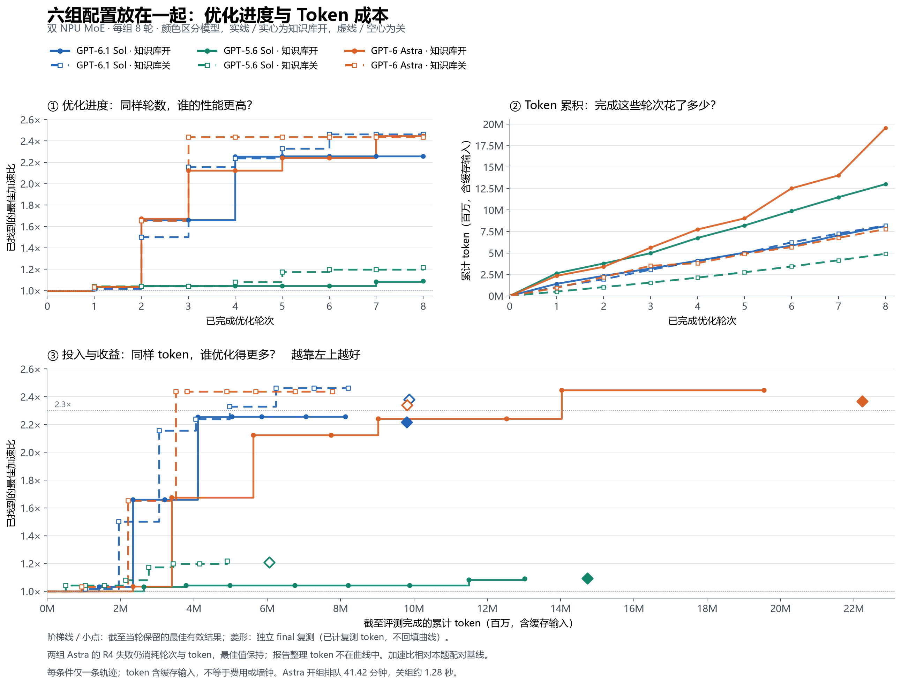

# 六组 Agent 的双 NPU MoE 优化结果

本目录发布已完成历史实验的**脱敏字段提取、源码快照与图**，对应
[需求 #252](https://github.com/InferMatrixLab/InferRSI/issues/252) 和
[PR #338](https://github.com/InferMatrixLab/InferRSI/pull/338)。六组依次执行，
每组一个全新会话、8 轮探索、一次独立 final：共 **48 轮探索（46 PASS、2 FAIL）**，
**6 次 final 全部 PASS**。PASS 的范围是冻结任务下的正确性与有效测量，
不代表生产服务验收或知识库效果的因果结论。

**历史实验直接调用既有 `inferrsi.harness.scenarios.external.execute_trial`，
没有使用 PR 新增的 TaskPackage 入口。** 本次发布不重新运行设备；不能用这些
历史成绩声称新入口已经完成 NPU 验证。

任务是一层完整、两卡 EP=2 的 MoE forward：8 个路由专家（每卡 4 个）加共享
专家，涵盖路由、重排、专家 MLP、归并和跨卡通信。基线是本题独立编写的可读
AllGather/ReduceScatter 实现，不是 vLLM 最新生产实现。三类性能场景是
64/256/1024 token 每卡、hidden 512/1024/2048，另有正确性边界用例。
完整数学语义、冻结门槛及参考来源见 [TASK.md](validator/task/TASK.md)。

| 模型（均 xhigh） | 知识库 | 入选轮次 | 独立 final 加速比 | 8 轮累计 token | final 增量 | 报告尾部 | 完整会话 token |
| --- | --- | ---: | ---: | ---: | ---: | ---: | ---: |
| GPT-6.1 Sol | ON | R5 | 2.216346× | 8,131,818 | 1,673,613 | 577,259 | 10,382,690 |
| GPT-6.1 Sol | OFF | R6 | 2.380696× | 8,202,212 | 1,665,783 | 533,633 | 10,401,628 |
| GPT-5.6 Sol | ON | R8 | 1.092386× | 13,016,364 | 1,716,556 | 3,155,714 | 17,888,634 |
| GPT-5.6 Sol | OFF | R8 | 1.207114× | 4,904,359 | 1,151,107 | 1,238,744 | 7,294,210 |
| GPT-6 Astra | ON | R7 | 2.367067× | 19,551,765 | 2,678,476 | 950,283 | 23,180,524 |
| GPT-6 Astra | OFF | R3 | 2.339809× | 7,774,716 | 2,039,682 | 600,255 | 10,414,653 |

总计 **79,562,339 token**。token 是实际请求 input+output 的累计数，已经包含
cached input；reasoning 是 output 的子集，不能再加一次。它不是货币账单。
每轮边界是完成评测的工具结果返回之后、下一条模型生成之前的延迟遥测快照，
包含此前检索、失败、等待交互等全部会话工作；final 与报告尾部单列。



阶梯线是截至当轮保留的最佳有效分数，慢轮和失败仍计成本；菱形是独立 final，
不回填探索曲线。两组 Astra 的 R4 都因当前 `npu_moe_finalize_routing` 不接受
`k` 参数而在候选正确性调用中失败，没有正式候选计时样本；分数为 null，
不是 0× 或 1×。两组均在下一轮删除该参数后通过。

**最终实现及搜索差异。** 六组均省去独立 logits AllGather，收集 BF16 输入后
重算复制 router；最终均保留 AllGather/ReduceScatter，没有交付 All2All 或
自定义 Triton kernel。6.1 两组采用原生路由、两次 grouped GEMM 与 FP32 finalize；
ON 回选 R5，仍有路由 count 主机读取；OFF R6 使用静态容量、设备端专家前缀、
显式清零无效尾部，并保留 shared 与异步 ReduceScatter 的交错。
5.6 ON 保留逐专家循环，OFF 使用批量 BMM 与 one-hot 前缀打包。
Astra ON 采用原生路由/GMM/finalize，仍读取有效计数；OFF 回选静态容量路由、
设备前缀 GMM、手工 FP32 combine 的 R3。详细轨迹见 [逐轮改动](results/changes.md)。

**能解释到哪里。** 每条件只有一条轨迹。OFF 仍使用 RSI 的执行、验收与证据链路，
只是禁用优化知识库正文；两边均允许公开技术资料。ON 确实增加了检索/阅读，
并有采纳记录，但没有逐份知识的消融实验。失败查询、材料宽泛、具体 API 从
公开资料获取，以及固定 8 轮下的搜索方向选择，都是观察到的过程；不能把
最终高低直接归因于知识库好坏。6.1 的两组总 token 实际基本相同。

6.1 final 的 2.381× 对 2.216×是**各自配对基线下的分数**，不是 OFF 代码直接
快 7.4%。两组 final 基线延迟几何平均相差约 6.54%；跨时段候选原始延迟几何
平均只差约 0.82%，且 medium 场景 OFF 更慢。这也不是控制时段后的直接对照。
异步安排和显式 wait 可从源码确认，实际隐藏多少通信时间没有独立时间线证明。

Astra ON 累计排队 **2,485.094 秒（41.42 分钟）**，OFF 约 1.280 秒；等待中的
模型交互 token 全部保留。共享机时段和物理卡不同，虽是相同型号/软件且使用
配对 baseline，也不能声称运行条件完全相同。分配进程墙钟包含初始化、CPU
oracle、预热、验证和计时，不是 NPU 忙时。公开资料允许访问但未全面冻结；
Astra 两组取到的上游提交不同，不过三份共同 API 文档的保存内容哈希相同。

**公开文件与复核入口。**

- [条件协议及来源](plan/README.md)、[脱敏计划](plan/publication.json)、
  [原件身份与省略范围](plan/provenance.json)。
- [54 次紧凑原始计时提取](results/measurements.jsonl.gz)：52 次成功的逐 case
  baseline/candidate 样本数组，2 次失败保留 null；数值未舍入。这里的样本已经
  按两个 rank 的较慢值聚合，不是完整逐 rank 原日志。
- [逐轮分数与 token](results/rounds.csv)、[会话成本](results/session-usage.csv)、
  [图所用摘要](results/summary.json)、[审计字段提取](results/audit-extract.json)。
- [候选清单](patch/candidates.csv)：48 份探索源码在确定性 ZIP 中，6 份最终源码
  直接可读；均保留原字节和 SHA256，包括失败、较慢及未入选候选。
- [冻结裁判说明](validator/README.md)、[完整 bundle 哈希](plan/integrity.json)。

从仓库根执行 CPU 复核，无须 NPU、模型调用或私有日志：

```bash
python evidence/moe-agent-comparison-20261104/verify.py
python tools/validate_evidence.py
```

重新绘制同一组数值（需要 Matplotlib；便携脚本用英文，不依赖 CJK 字体）：

```bash
python evidence/moe-agent-comparison-20261104/render_overview.py --output /tmp/moe-overview
```

输出目录可替换为本机临时目录。中文原 PNG 直接复制自历史结果，重新绘制不覆盖它；
便携版保留相同三图与数值，英文文案、字体和 Matplotlib 版本会改变像素布局。
生成脚本仅使用本目录公开摘要。
`build_public.py --source <AUTHORIZED_ARCHIVE> --output <OUTPUT_DIRECTORY>` 可由有权
访问原始归档的人重新提取数据；该归档未公开，普通读者无法独立重放完整条件/
会话访问审计。CPU 复核证明公开数据内部一致、可用字节及统计可重算，不等于
重新测量性能，也不把外部审计原件变成已公开可验证材料。
