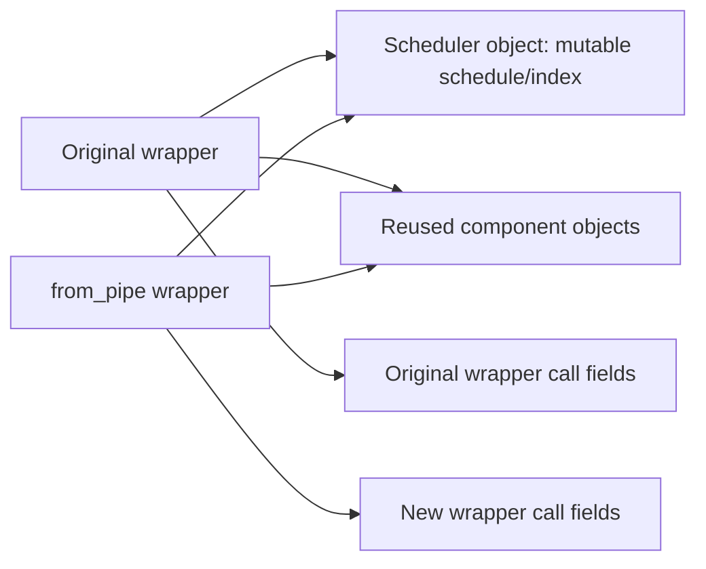

# Wrapper, scheduler and invocation ownership

IDs refer to [source-map.md](source-map.md).

| Responsibility | Inspected owner | Lifetime consequence |
|---|---|---|
| guidance/attention/current-timestep/interrupt fields | FluxPipeline wrapper (S2/S4) | The same wrapper receives new per-call assignments. Another wrapper has separate wrapper fields. |
| timesteps/sigmas/step_index/begin_index | FlowMatchEulerDiscreteScheduler object (S3) | New wrapper identity does not establish independent scheduler state if components are reused (S1). |
| model weights and model-internal state | Component objects, outside this model-forward readset | Weight reuse is distinct from scheduler/request isolation; no model thread-safety guarantee is derived. |
| admission, overlap and cancellation policy | Actual application caller, not established here | Inspect its real serialization/ownership contract before proposing a change or a race finding. |

Concrete cycle: Flux call assigns wrapper fields → retrieve_timesteps calls scheduler.set_timesteps → scheduler replaces schedules/resets indices → Flux sets begin_index(0) → each step initializes/advances scheduler index → callback can set interrupt → next loop boundary skips further model work → normal tail clears current timestep and outputs latent or decoded image before freeing hooks.

This diagram describes default component references in the inspected path, not a measured concurrency failure. Explicit component overrides and the caller's invocation contract can change the ownership graph.

Interruption skips later loop work; it does not retroactively undo a completed step or already submitted device work. The normal output tail is not a proof that every exception executes cleanup. Returned partial latents/images need their own output/quality contract.
