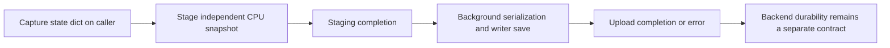

# DCP Asynchronous Save Performance

Status: candidate; source-supported decision procedure, no local training or
save-performance measurement. Read [source and version boundaries](references/sources.md)
before applying APIs. Reading this skill authorizes no experiment or command.

## Scope and decision order

SSD / Storage → Observe, Configure, Optimize, Verify; RAM / Host → Observe,
Configure, Optimize, Verify; Accelerator → Diagnose (exposed staging pause).
Device-to-host copies belong to the host/device link; shared CPU staging for a
checkpoint process is same-host IPC. Neither fills a network-optimization cell.
Distributed recovery validity belongs to `checkpoint-recovery-consistency`.

1. Record the installed PyTorch revision, stager, storage writer, thread/process
   executor, checkpoint contents and ranks per host. The tutorial's base async
   example requires 2.4+, while its `DefaultStager` section says 2.9+. These
   version labels alone do not establish the exact API of a particular wheel.
2. Separate caller-side state-dict construction and staging from background
   serialization/write work. At the inspected implementation, Stateful
   `state_dict()` calls still happen on the caller before staging submission.
   Do not promise that all checkpoint preparation leaves the training thread.
3. Locate the next mutation of **any checkpointed state**. The tutorial waits
   before `optimizer.step()`, appropriate to its example; models that mutate
   buffers during forward or other state earlier require an earlier boundary.
4. Select the smallest justified lever below, retaining one outstanding save
   as the initial policy. No host setting or hardware run is authorized here.

## Completion and lifetime contract

| Boundary | What it permits | What it does not establish |
|---|---|---|
| `async_save` returns | Background work was submitted; synchronous staging paths have already copied state | Save success, durability or successful asynchronous staging |
| `staging_completion.result()` succeeds for an asynchronous stager | Local snapshot copies finished; source state can mutate under the chosen snapshot contract | Writer finished reading cached CPU buffers; durable checkpoint |
| `upload_completion.result()` succeeds, or the legacy returned future's `result()` succeeds | The selected save executor completed; errors must be observed | Crash recovery under arbitrary backends or semantic completeness of application state |
| Previous upload completed, then next staging begins | Reusing the same stager's cached CPU storages no longer overwrites data still being saved | Unlimited safe concurrency or automatic backpressure |
| Final upload observed, then caller-owned `stager.close()` | Release staging thread/cache resources | Implicit cleanup of an unfinished writer |

At the pin, `DefaultStager` is not thread-safe and uses one staging worker.
Its storage cache copies new contents into previously allocated CPU storage.
Therefore staging completion is sufficient for source mutation, but **upload
completion is the reuse gate** for that cached snapshot. One worker does not
limit the caller to one in-flight save; the caller must enforce the limit.
Internally created stagers have automatic cleanup in the inspected revision;
explicitly supplied stagers remain caller-owned.

## Choose an incremental performance lever

| Observed cost | Candidate | Resource cost / rejection signal |
|---|---|---|
| Blocking GPU→CPU staging dominates training pause | Explicit asynchronous `DefaultStager` with correctly placed staging wait | Background CPU work, copy-engine/host-device-link contention; reject overlap that races a state mutation |
| Repeated staging allocation/copy cost, enough host headroom | Reuse a pinned CPU staging cache (`cache_staged_state_dict` in the legacy writer, or the current storage-caching stager) | Persistent locked RAM; first-use allocation differs from steady state; never reuse before prior upload completion |
| Write completion lags checkpoint cadence | Await the prior upload before another save; assess cadence against the caller's recovery requirements | Training backpressure may remain; queueing more requests trades RAM/I/O pressure for latency rather than creating bandwidth |
| CPU or input workers slow while saving | Account for staging, serialization and I/O workers together before increasing concurrency | CPU saturation, host-memory bandwidth or shared-disk contention; asynchronous return time alone misses this cost |

Budget host staging as the sum of per-rank snapshot storage on that host,
multiplied by simultaneous independent snapshots, plus serialization/allocator
and input-pipeline overhead. This is a planning estimate, not measured RSS;
aliasing, sharding and caching affect the actual allocation. Pinned buffers
remain resident and compete with dataset caches and runtime offload.

The inspected `FileSystemWriter` disables `per_thread_copy_ahead` in its async
staging path because the snapshot is already on CPU. Do not suggest increasing
that GPU copy-ahead parameter as an async-save speed knob without confirming
the executing writer path. Writer thread count is not guaranteed throughput.

## Evidence to request in a separately authorized measurement

Record caller entry/return, staging completion, upload completion and exposed
waits on the training thread. Keep `caller pause`, `staging elapsed`, `upload
elapsed` and `step wall time` distinct; overlapping durations cannot be added
as if serial. Compare both checkpoint steps and intervening steps with the same
model/state/cadence, and retain first-use versus reused-buffer measurements.

Capture per-host RSS/locked memory, ranks and snapshot bytes, CPU load, input
wait and physical storage/network traffic for the selected backend. Match
all-rank participation and shutdown waits to the actual configuration. These
are proposed measurements, not results from this skill extraction.

## Limits

- No NPU qualification. Generic accelerator calls in implementation do not
  override CUDA-oriented documentation or establish torch_npu support.
- No asynchronous-return-as-durability claim. `FileSystemWriter.sync_files`,
  stream `fsync` support and metadata publication are backend-specific; even
  writer completion is not a power-loss test.
- No broad DCP restore, Megatron or DeepSpeed checkpoint investigation. State
  completeness, distributed generation selection and recovery failure domains
  require their own evidence.
- No empirical gains or promotion. See the source note for tutorial/code
  differences and a pinned completion-edge caveat.
