# Complete state and lifetimes

The [source ledger](source-notes.md) defines F1–F7. F labels mean pinned
implementation contracts; DOC describes source intent; P below means a proposed
audit procedure. Reading tests is TEST-SOURCE, not their execution.

## Complete state

A GPU checkpoint has a consumed-token endpoint, a parent link, additional
immutable complete pages and a snapshot of the endpoint's continuation state.
The full page chain is obtained through the parents. A page ID covers the
corresponding cache storage across layers; a snapshot ID covers the recipe's
complete continuation state and saved hidden vector (F2).

The offload design names the partial tail page, recurrent matrices, convolution
histories, selector rings, sliding windows and last hidden state as row-resident
continuation data. The exact planes and byte counts come from the prepared
model's geometry, not from an assumed transformer KV shape. `CacheGeometry`
contains page planes and row planes; `Layout` accounts for the records across
ranks (F3). This supports a completeness audit, not a claim that each model
uses every named state type.

| Object | Completeness requirement | Invalid shortcut |
|---|---|---|
| GPU publication | Nonzero endpoint; snapshot token count exactly equals it; ready, matching parent; exactly the additional complete pages; unique in-capacity page/snapshot IDs | Treating any allocated KV block list as a checkpoint |
| Host endpoint | Endpoint row exists and is ready; chain pages are readable back to a sufficient resident GPU ancestor or root | Accepting a rowless compacted node as a resumable endpoint |
| Intermediate host node | May supply readable pages without an endpoint row | Rejecting all useful chain pages merely because an intermediate row was compacted |
| Persisted record | Header version, namespace identity, layout fingerprint/name and record shape agree; required ancestors survive scan | Reusing an ordinary-execution row for speculative state because token text matches |

`Index::lookup_below` searches deeper matches before shallower ones, but
`Index::chain` rejects an endpoint without a row or an unreadable required node.
A resident GPU prefix can cover ancestors that no longer need to be fetched
(F3). The audit therefore records the resident endpoint as well as the host hit.
It does not require fetching an already resident prefix again.

The source namespace separates incompatible storage identities/layouts and
ordinary versus speculative execution. Compatible positive draft limits and
verification policies are described as reuse-preserving in the design; do not
infer compatibility from the word "speculative" alone. The HTTP test source
explicitly checks an ordinary-to-speculative miss and subsequent matching
restart reuse (F6). No such server was run for this delivery.

## Ownership and completion

```mermaid
flowchart LR
    L["Host chain match"] --> C["Cost accepted"] --> R["Reserve ticket: pages + snapshot + parent pin"]
    R --> Q["Fetch enqueued; request is Inbound"]
    Q --> T["StoreEvent::Fetched after accounted transfer completion"]
    T --> P["finish_inbound: publish complete GPU checkpoint"]
    P --> U["Surviving waiters enter Restore"]
    U --> E["Later GPU use and logical retirement"]
    E --> F["Completed fence reaches retire_after"] --> B["Storage reusable"]
    Q -. "cancel waiter only" .-> W["Ticket and transfer remain owned"]
    W --> T
```

| Transition | Owner and release condition | Evidence |
|---|---|---|
| Outbound copy starts | Worker pins the GPU checkpoint for a queued store; `Stored` or `Deferred` ends that copy-out pin; a retry retains an ID rather than an eternal pin | `PrefixStore` and worker publication/poll path, F3/F5 |
| Inbound reserved | Scheduler ticket owns free destination page IDs, one snapshot and the resident parent pin; several waiters can share the key | `admit_planned`, F4 |
| Waiter cancelled | Scheduler removes the waiter through `retire`; it does not destroy the ticket or promise cancellation of CUDA work | `cancel`/`retire`, F4 |
| Inbound succeeds | Worker calls `finish_inbound(key, true)` only from accounted fetch completion. A new checkpoint owns the ticket resources; surviving waiters receive shared pages/snapshot and enter `Restore` | F4/F5 |
| Existing checkpoint wins | After the completed copy, duplicate destination pages/snapshot are returned and waiters attach to the existing checkpoint. If it is not ready, waiters are retired for re-admission | `finish_inbound`, F4 |
| Enqueue rejected | `fetch` returns an error and promises no later event. The worker fails the ticket and admits normally | F3/F5 |
| Confirmed inbound fails | `finish_inbound(key, false)` releases the ticket resources/parent pin; worker requeues affected requests with host lookup disabled for that attempt | F4/F5 |
| Completion becomes unaccountable | `PrefixStore::poll` error means transfers may still access the IDs; worker must stop instead of releasing them as an ordinary fetch failure | F3/F5 |
| Shutdown | Store/transfer drain and executor drain must be confirmed before scheduler releases ownership; a failed drain retains the owners | F4/F5 |

`Transfers::submit` rejects an already-pending `(id, window)`, full queue,
stopped thread or closed transport. Accepted work is tracked per rank;
`poll` merges rank replies and releases the pending job only after all replies
have been accounted for. `close` drives progress, joins threads and returns an
error when the drain cannot be confirmed (F5). These are source-level
obligations; they do not qualify multi-host behavior or hardware fault recovery.

## Three distinct fences

`Fence` is one ordered completion timeline that must cover relevant model work
and asynchronous copies. The cache itself does not manufacture GPU completion
(F2).

1. **Publication:** `ready_after` protects the writes creating the checkpoint.
   `advance_completed` makes it visible only after that fence. Publication
   metadata can exist before lookup/use is legal.
2. **Use:** `mark_used(id, through)` requires readiness and extends `last_use`
   through the full ancestor chain. A finished client response does not clear
   outstanding uses.
3. **Retirement:** logical removal produces `RetiredResources` with
   `retire_after = max(last_use, ready_after)`. Only `advance_completed` returns
   reusable pages/snapshots after reaching it. Ancestor compaction transfers
   pages and outstanding-use protection into its child while retiring the old
   row. `cancel_publication` accepts only an unpublished, unpinned leaf without
   children; it still goes through retirement.

P: For a suspected early reuse, tabulate endpoint, parent, pages, snapshot,
ready-after, last-use, retire-after, completed fence and actual free-list return.
The first unsupported edge identifies the missing owner or event; a high
retired-page count while a fence is pending is a counter-signal to a leak claim.
