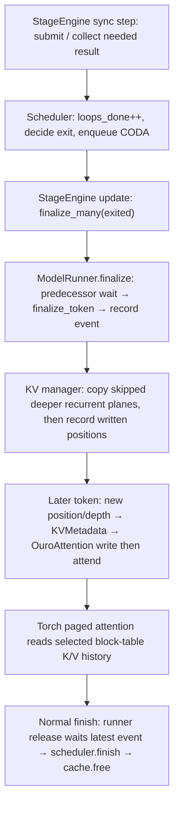

# Pinned vLLM-RLT source observations

Source: InferMatrixLab/vllm-rlt at `4a350344027960a48384626aa646f1765fda6d4f`, tree `4c2cab1f497513ea0590060eb53ee0b179a5bf70`. Repository ID 1363830789 preserves the former ThinkFlowLab owner lineage. Identity/license acquisition on 2026-10-23 is retained from the descriptor intake; the added caller/consumer files were read at the same immutable tree. The [file ledger](source-identity.json) records exact blobs, byte hashes, roles and bounded ranges. Only this readset is claimed.

## Applicability and inference boundary

The selected view is native Ouro, synchronous host KVMetadata, LAST_EXITED with SHARED as a control, Torch reference attention, no speculation/connector/preemption/prefix sharing, and no graph/static-buffer/split/packed-prefill qualification. Source call order supports the diagnostic procedure. It is not evidence of executed output correctness, CUDA completion or performance. The root's two invariants are source-derived diagnostic rules.

## Call and data edges

All source links below use the full fixed revision. These are observed call/data edges, not an assertion that every backend, stream, model or failure combination is correct.

| Edge / responsibility | Exact source anchors |
|---|---|
| Synchronous entry, host-dependent collection and update | [stage_engine.py:403–439](https://github.com/InferMatrixLab/vllm-rlt/blob/4a350344027960a48384626aa646f1765fda6d4f/vllm_rlt/engine/stage_engine.py#L403-L439), [model_runner.py:123–149](https://github.com/InferMatrixLab/vllm-rlt/blob/4a350344027960a48384626aa646f1765fda6d4f/vllm_rlt/worker/model_runner.py#L123-L149). PRELUDE/prompt work need not collect immediately; synchronous scheduling is not a claim that every submission blocks. |
| Exit producer and copy caller | [scheduler.py:756–767](https://github.com/InferMatrixLab/vllm-rlt/blob/4a350344027960a48384626aa646f1765fda6d4f/vllm_rlt/core/scheduler.py#L756-L767), [839–860](https://github.com/InferMatrixLab/vllm-rlt/blob/4a350344027960a48384626aa646f1765fda6d4f/vllm_rlt/core/scheduler.py#L839-L860); [stage_engine.py:602–623](https://github.com/InferMatrixLab/vllm-rlt/blob/4a350344027960a48384626aa646f1765fda6d4f/vllm_rlt/engine/stage_engine.py#L602-L623). |
| Select ordinary copying branch and propagate dependencies | [model_runner.py:339–357](https://github.com/InferMatrixLab/vllm-rlt/blob/4a350344027960a48384626aa646f1765fda6d4f/vllm_rlt/worker/model_runner.py#L339-L357), [1278–1284](https://github.com/InferMatrixLab/vllm-rlt/blob/4a350344027960a48384626aa646f1765fda6d4f/vllm_rlt/worker/model_runner.py#L1278-L1284), [1331–1344](https://github.com/InferMatrixLab/vllm-rlt/blob/4a350344027960a48384626aa646f1765fda6d4f/vllm_rlt/worker/model_runner.py#L1331-L1344). `async_state` is absent in the selected synchronous view. |
| Copy, logical validity and layout | [manager:449–468](https://github.com/InferMatrixLab/vllm-rlt/blob/4a350344027960a48384626aa646f1765fda6d4f/vllm_rlt/core/kv_cache_manager.py#L449-L468), [513–514](https://github.com/InferMatrixLab/vllm-rlt/blob/4a350344027960a48384626aa646f1765fda6d4f/vllm_rlt/core/kv_cache_manager.py#L513-L514), [747–772](https://github.com/InferMatrixLab/vllm-rlt/blob/4a350344027960a48384626aa646f1765fda6d4f/vllm_rlt/core/kv_cache_manager.py#L747-L772). Exit-depth readiness is checked for configured recurrent layers; the copying loop preserves executed planes. |
| Next token's address/depth | [scheduler.py:789–798, 834–879](https://github.com/InferMatrixLab/vllm-rlt/blob/4a350344027960a48384626aa646f1765fda6d4f/vllm_rlt/core/scheduler.py#L789-L879), [request.py:96–120](https://github.com/InferMatrixLab/vllm-rlt/blob/4a350344027960a48384626aa646f1765fda6d4f/vllm_rlt/request.py#L96-L120), [executor.py:16–95](https://github.com/InferMatrixLab/vllm-rlt/blob/4a350344027960a48384626aa646f1765fda6d4f/vllm_rlt/worker/executor.py#L16-L95). CODA appends a token; a following PRELUDE resets loop progress; recurrent spans bind actual request position and zero-based depth. |
| Prepared metadata and actual consumer | [MetadataBuilder:162–238](https://github.com/InferMatrixLab/vllm-rlt/blob/4a350344027960a48384626aa646f1765fda6d4f/vllm_rlt/worker/metadata.py#L162-L238), [stage_metadata:148–194](https://github.com/InferMatrixLab/vllm-rlt/blob/4a350344027960a48384626aa646f1765fda6d4f/vllm_rlt/worker/buffers.py#L148-L194), [ModelRuntime:194–203](https://github.com/InferMatrixLab/vllm-rlt/blob/4a350344027960a48384626aa646f1765fda6d4f/vllm_rlt/worker/executor.py#L194-L203), [OuroAttention:171–186 / core:283–291](https://github.com/InferMatrixLab/vllm-rlt/blob/4a350344027960a48384626aa646f1765fda6d4f/vllm_rlt/models/ouro.py#L171-L291), [manager:664–744](https://github.com/InferMatrixLab/vllm-rlt/blob/4a350344027960a48384626aa646f1765fda6d4f/vllm_rlt/core/kv_cache_manager.py#L664-L744), [Torch paged attention:12–36](https://github.com/InferMatrixLab/vllm-rlt/blob/4a350344027960a48384626aa646f1765fda6d4f/vllm_rlt/kernels/paged_attention.py#L12-L36). Host rows retain allocation/depth/position; each model layer writes K/V before attending to its selected history. |
| Completion and storage retirement | [next-submit wait:1149–1194](https://github.com/InferMatrixLab/vllm-rlt/blob/4a350344027960a48384626aa646f1765fda6d4f/vllm_rlt/worker/model_runner.py#L1149-L1194), [release:1346–1375](https://github.com/InferMatrixLab/vllm-rlt/blob/4a350344027960a48384626aa646f1765fda6d4f/vllm_rlt/worker/model_runner.py#L1346-L1375), [StageEngine finish:626–640](https://github.com/InferMatrixLab/vllm-rlt/blob/4a350344027960a48384626aa646f1765fda6d4f/vllm_rlt/engine/stage_engine.py#L626-L640), [Scheduler finish:181–193](https://github.com/InferMatrixLab/vllm-rlt/blob/4a350344027960a48384626aa646f1765fda6d4f/vllm_rlt/core/scheduler.py#L181-L193), [manager free:358–365 / references:191–196](https://github.com/InferMatrixLab/vllm-rlt/blob/4a350344027960a48384626aa646f1765fda6d4f/vllm_rlt/core/kv_cache_manager.py#L191-L365). Free drops allocation references; blocks become reusable at zero references. It does not erase physical bytes or deallocate the whole tensor pool. Transfer-lease deferral and prefix retention are outside the selected tuple. |

The manager's host-written tracker keeps a contiguous prefix plus sparse pending positions (32–50), and host-row attention requires the complete prefix (686–693, 726–727). Reserved token capacity is not that prefix. `DeviceKVMetadata` is explicitly different (metadata.py:45–54; manager.py:716–723) and is not generalized from these checks.

## Import and validation boundary

The package initializer imports the LLM entry point; manager, request, metadata, buffer and backend modules require real Torch. The project declares Python >=3.10 and Torch >=2.5 plus its other CPU dependencies. The original test conftest also imports Torch. A native test requires the intact package/dependency closure, not an extracted class or replacement formula. The manager tests use real CPU Torch tensors; their inspected assertions are not executed results. Native CPU/CUDA, model, quality, performance and agent-efficacy validation remain not_run.

The original test tuple is CPU/float32/Torch attention with 2 layers, 1 KV head, head dimension 4, block size 2, 18 blocks and 3 maximum loops. It probes cache mechanics independently of the source Ouro default of 4 UT steps and does not qualify a loaded model.

## License and retained attribution

The upstream root [LICENSE](../LICENSE) is retained byte-for-byte. [NOTICE](NOTICE.md) retains ByteDance/Ouro-1.4B architecture/configuration revision `574fa66cb8bf5abdc979642d01cf2b79b16bfab1` and Qwen/Alibaba/HuggingFace attribution. The newly inspected Ouro source repeats this Apache-2.0 lineage at 1–5. Procedure prose paraphrases the bounded implementation; no implementation code is copied. Model weights and their complete licensing were not audited.

The fixed README at 70–75 recommends the synchronous path and records unresolved asynchronous-preemption output and asynchronous-self-speculation cleanup warnings. Those warnings are preserved as exclusions, not treated as repaired. The capacity planner, native Triton/FlashAttention implementations and asynchronous routing kernel are not mechanisms distilled here.
