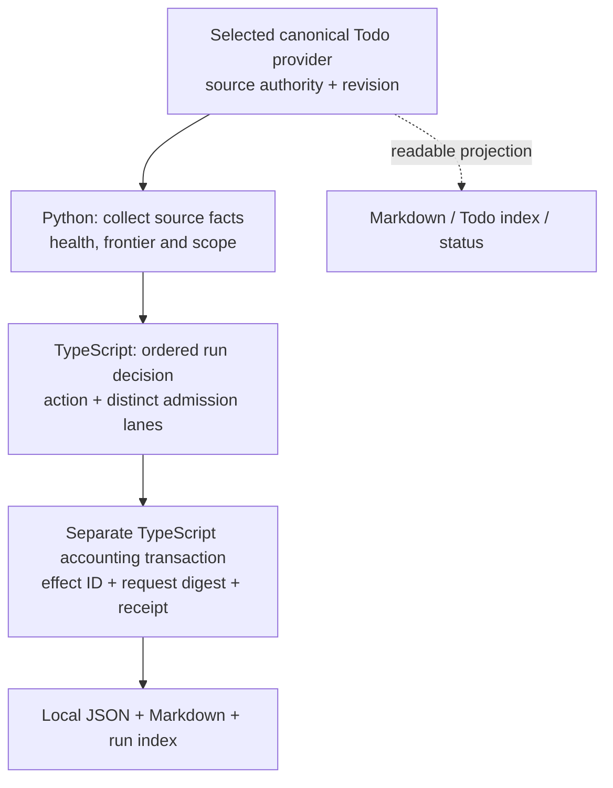

# LoopX Goal authority and quota boundaries

Use this source-derived candidate when reviewing an agent's proposed next action,
a stopped Goal, or a repeated quota settlement. It supplies questions and
counterexamples for the existing RSI evidence workflow; it does not implement a
controller or change InferRSI's RunSpec, authorization or verdict rules.

The source is [LoopX at `f094b2cfb2acde7a4a0d4d875bba52f64ac31ba9`](https://github.com/loopx-project/loopx/tree/f094b2cfb2acde7a4a0d4d875bba52f64ac31ba9),
inspected on 2026-10-26. [The ledger](source-ledger.json) records actual file
bytes, Git blob identities, inspected sections and exclusions. Code, document
intent, test assertions and deductions have separate meanings. Upstream tests
were read, not run; empirical validation is `not_run` and agent efficacy is not
evaluated.

## Choose the question

| Question | Read | Observation to retain |
| --- | --- | --- |
| Is this the current Todo authority or a readable view? | [Authority and projections](mechanisms.md#authority-and-projections) | Selected provider, revision, complete source availability and Goal identity |
| Does `should_run` permit delivery, repair or another bounded action? | [Decision ownership and order](mechanisms.md#decision-ownership-and-order) | Admission lanes, effective action, reason and the guard that changed them |
| Is a retry the same accounting effect? | [Accounting identity and recovery](mechanisms.md#accounting-identity-and-recovery) | Effect ID, semantic request digest, index basis and durable receipt |
| Can an old event file or a missing receipt be treated as empty? | [Retirement and external effects](mechanisms.md#retirement-and-external-effects) | Explicit refusal or uncertainty; preserve the source and recovery evidence |
| What would expose an incorrect interpretation? | [Decision cases](decision-cases.md) | Source-supported expected result and the tempting unsupported conclusion |



The diagram shows inspected responsibilities, not an atomic transaction across
these layers. A returned decision does not execute work. Accounting artifacts
do not fence an external host or provider effect.

## Apply the knowledge

1. Identify the source revision and affected Goal. If an exact `GoalRef` is
   required, retain both the Goal ID and its instance ID.
2. Establish source availability before interpreting counts or recommendations.
   Distinguish missing state, unavailable provider and valid empty state.
3. Read the action and all admission lanes together. Check the ordered guards
   before treating a repair or inbox action as normal delivery permission.
4. For accounting recovery, distinguish repeating the original commit from a
   replay lookup. Compare identity and request semantics before retrying.
5. Record the remaining uncertainty and the next authorized check. Keep
   execution status, task acceptance and `PASS` / `FAIL` / `INCONCLUSIVE`
   separate.

The examples are review aids, not permission to execute LoopX, restore a Goal,
remove files or spend compute. The historical reference for InferRSI RFC #137
remains `a6f28057b49fe03bb234fa6ce1bac5d61df0c58f`; this newer knowledge readset
does not replace that pin or deliver its checkpoint implementation.

## Read through InferRSI

With the optional `skills` parser installed:

```bash
inferrsi skills resource rsi-evidence references/loopx-goal-governance/mechanisms.md
inferrsi skills reference optimization-search-policy ../../workflows/rsi-evidence/references/loopx-goal-governance/README.md
```

The generated catalog's `inferrsi.common.skills.rsi_evidence` record links the
complete owner, including these resources. Reading, indexing or packaging the
material does not establish LoopX runtime behavior or incremental skill benefit.

## License and attribution

The pinned source uses Apache-2.0. Preserve its original [LICENSE](LICENSE)
and [NOTICE](NOTICE.md). The notice credits LoopX contributors and its creator
huangruiteng, and records MIT distribution through v0.4.7; the retained
[historical MIT text](LICENSE-MIT.md) does not relicense current code.
These references paraphrase the inspected mechanisms; no LoopX runtime is
bundled and no enterprise affiliation is inferred.
