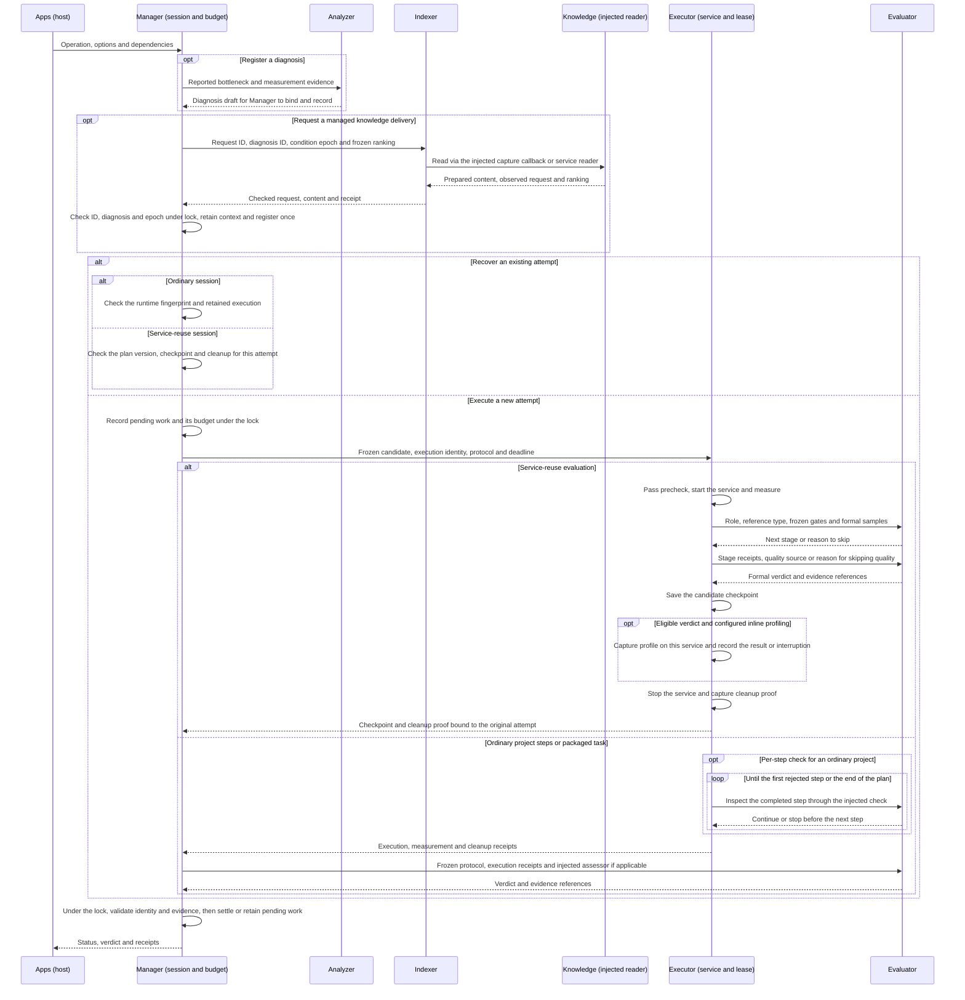

# Harness

Harness owns execution, source checks, budget accounting, recovery, and
retained run evidence. Apps assembles runtimes and ports. Benchmark defines
measurement and assessment rules.

## Entry points

- [the public API](api/__init__.py) exposes `Harness.allocate`, `execute`, and `read` for local
  CPU commands. [`local_process.py`](local_process.py) owns the process domain.
- [Records](records/__init__.py) provides `RunStore` and `RunStoreReader` for
  namespaced records and content-addressed artifacts. Pass `record_version`
  to read a fixed record and use `open(ref)` to read retained artifact bytes.
  The [service observation reader](records/service_observations.py) reconstructs settled
  rounds, including older embedded profiles. Service readers and writers share the
  [path, JSON and diagnostic limits](records/service_io.py).
- [`optimization_session.py`](optimization_session.py) connects session
  commands to the budget and recovery logic in [`optimization.py`](optimization.py).
  [`task_protocol.py`](task_protocol.py) prepares task protocol packages and runs
  their operations in a subprocess with source hash and response checks.
- [`skill_evaluation.py`](skill_evaluation.py) executes and retains
  skill-evaluation trials. [`artifact_sandbox.py`](artifact_sandbox.py) captures
  and replays submitted artifacts.
- [Manager](manager/__init__.py) exposes the common AB/BA loop as
  `from inferrsi.harness.manager import run_experiment`. Apps supplies the
  `execute`, `snapshot`, `assess` and `report` ports. Manager records the
  returned assessment. [External trials](trials/external.py) run and retain
  each command with the supplied metric reader.
- Manager also exposes `EngineSearchPlan`, `run_engine_search` and
  `read_engine_search`. It checks the budget before starting a search.
  Its [improvement loop](manager/search/improvement.py) uses injected assessments.
  [VATS](manager/search/vats.py) selects edits and verification jobs. The
  [search campaign](manager/search/search_campaign.py) coordinates GVO updates
  and final evaluation, and [work control](manager/search/work_control.py)
  records claims, receipts and budget use in the RunStore.
  See the [speculative search design](../../../docs/guides/speculative-search.md) for recovery rules.
- [Executor](executor/__init__.py) supplies `runtime_environment` so that child
  processes use the same InferRSI installation as their parent.

## Managed optimization loop

`campaign` and `benchmarks session` enter through [session_command](optimization_session.py).
The agent chooses a hypothesis and edits a candidate between rounds.

- **Manager** owns the session ledger, round and time budgets, pending work, recovery and final
  retests. These operations currently share the [round controller](optimization.py).
- **Analyzer** [validates the reported bottleneck and measurement summary](analyzer/__init__.py).
  [Manager](optimization.py) records the diagnosis ID, time and condition epoch. The performance-ceiling
  analysis skill lives in Knowledge.
- **Indexer** [checks managed deliveries](indexer/__init__.py) against the frozen ranking.
  Apps injects the ordinary in-memory capture callback or the service context reader.
  Knowledge [ranks matches](../knowledge/knowledge_find.py)
  and assembles context within the requested byte budget. The capture records delivered material,
  revisions and omissions. A new session can use `--ranking-policy applicability` to raise the
  applicability weight from 2 to 3. The default keeps the original six weights.
- **Executor** owns the retained candidate, task runner and [service lifecycle](project_service.py),
  including measurement collection, process ownership and cleanup.
- **Evaluator** uses the frozen rules and stage receipts to decide the next stage or verdict.
  [_session_assess](optimization_session.py) dispatches packaged tasks to their protocol
  assessor and project trials to the [AB/BA assessor](project.py). Service screening is
  diagnostic. [Service evaluation](project_service.py) uses formal samples and quality evidence.

New plans freeze the ranking ID, scoring version and all effective weights. Ordinary
plans and delivery receipts include a configuration digest. Service plans, manifests
and deliveries retain the values directly. Use the original runtime to continue a
historical plan without these fields or a session whose installed rule has changed.

To reproduce a ranking experiment, pin the scoring runtime revision and the complete
eligible corpus alongside the query, filters and policy. Document frequency and median
body length depend on entries outside the delivered context. The [ranking regression](../../../tests/apps/test_indexer_deliveries.py)
runs both policies against the same [complete corpus](../../../tests/fixtures/indexer/ranking-corpus)
at that Git revision. It also verifies an old capture after an undelivered entry changes
the score in a fresh search.

## Managed session interfaces

This diagram describes the component boundaries accepted for the [Harness migration](https://github.com/InferMatrixLab/InferRSI/issues/702).
The loop runs synchronously. Manager alone commits session state. Executor owns live processes
and leases. Evaluator reads frozen criteria, references and stage receipts.

Each deliberate dispatch receives a new request ID. Redelivery of the same request can
commit once. A fresh diagnosis invalidates an outstanding result, even within the same
condition epoch. If these calls move to worker threads, Manager will persist pending work
under the lock before waiting and recheck request identity, deadline and cleanup on return.
Workers can exchange immutable inputs and evidence references. Live processes, leases and
storage connections stay with their owners.

The ordinary project runner inspects each completed step before starting the next one.
Final assessment reuses the same inspection rules. In a service-reuse candidate, a
successful gate check or formal performance failure permits inline profiling after the
checkpoint and before cleanup. A quality failure skips profiling. If that capture is
interrupted, recovery uses the checkpoint and retained capture progress. The separate
profile backfill operation uses its own live service, capture allowance and cleanup
receipt. Evaluator consumes the recorded results. Executor owns each live capture.

## Evaluate retained runs

With the Apps saved-request CLI, a trusted caller allocates the attempt before
execution. Use `--runtime-config` to supply the trusted runtime for `prepare`
and `execute`. The `--storage-config` file authorizes retained data access,
including the RunStore mount selected by its Harness namespace. Use
`--output-id` to publish the operation result. `execute --capture-evidence`
opts a fresh attempt into production proof capture. Assessment reads fixed
retained evidence.
See the [evaluation options and replay behavior](../../../docs/guides/apps-evaluate-cli.md),
the [iterative workflow](../../../docs/guides/optimization-workflow-unification.md),
and the [improvement workflow](../../../docs/guides/harness-improvement.md).

For extension points, see the [architecture](../../../docs/architecture.md#where-to-extend).
The [RunStore tests](../../../tests/harness/test_harness_run_store.py) and
[task protocol tests](../../../tests/benchmark/test_qwen_optimization_protocol.py) cover
the storage and execution boundaries.

The [pre-migration session fixtures and replay instructions](../../../tests/fixtures/optimization-session/component-freeze/README.md) record the ordinary and service-reuse contracts at the start of the component migration.
