# Harness

Harness owns execution, source checks, budget accounting, recovery, and
retained run evidence. Apps assembles runtimes and ports. Benchmark defines
measurement and assessment rules.

## Entry points

- [Executor](executor/__init__.py) exposes `execute_attempt(store, target, spec)` for
  single-attempt execution. The [Executor supervisor](executor/local_process.py) owns the process domain.
- [Records](records/__init__.py) exposes `allocate_attempt(...)` and provides
  `RunStore` and `RunStoreReader` for namespaced records and content-addressed artifacts.
  Use `RunStoreReader.read(attempt_id, record_version)` to replace the former `Harness.read`. Pass `record_version`
  to read a fixed record and use `open(ref)` to read retained artifact bytes.
  The [service observation reader](records/service_observations.py) reconstructs settled
  rounds, including older embedded profiles. Service readers and writers share the
  [path, JSON and diagnostic limits](records/service_io.py).
- [Manager](manager/__init__.py) exposes `run_session` for typed requests such as
  `StartProjectSession`, `StartBenchmarkSession`, `EvaluateSessionRound` and `RecoverSession`.
  Apps resolves task resources and supplies the ranking policy, knowledge reader and assessor.
  Hosts use `read_session_records` to read the retained plan, rounds and final assessment.
  [Executor](executor/__init__.py) exposes `prepare_task_protocol` to freeze task resources
  and `run_task_protocol` to run their operations in an [isolated child](executor/protocol_child.py).
  For an ordinary project, `prepare_project` freezes the checks and `execute_ordinary` runs each
  allowed step before the shared deadline. [Evaluator](evaluator/__init__.py) checks each
  completed step before Executor launches the next process.
- [Skill trials](executor/skill_evaluation.py) execute commands and retain their results.
  The [artifact sandbox](executor/artifact_sandbox.py) captures
  and replays submitted artifacts.
- [Manager](manager/__init__.py) exposes the common AB/BA loop as
  `from inferrsi.harness.manager import run_experiment`. Apps supplies the
  `execute`, `snapshot`, `assess` and `report` ports. Manager records the
  returned assessment. [External trials](executor/trials/external.py) run and retain
  each command with the supplied metric reader.
- Manager also exposes `EngineSearchPlan`, `run_engine_search` and
  `read_engine_search`. It checks the budget before starting a search.
  Its [improvement loop](manager/search/improvement.py) uses injected assessments.
  [VATS](manager/search/vats.py) selects edits and verification jobs. The
  [search campaign](manager/search/search_campaign.py) coordinates GVO updates
  and final evaluation, and [work control](manager/search/work_control.py)
  records claims, receipts and budget use in the RunStore.
  See the [speculative search design](../../../docs/guides/speculative-search.md) for recovery rules.
- [Executor](executor/__init__.py) supplies the host's `LocalCpuTarget`, the
  canonical `request_digest` and `runtime_environment`. Child processes use the
  same InferRSI installation as their parent. Manager calls `process_group_empty`
  on Executor when verifying a recorded service's process group.
  Import `launch_server` and `stop_server` from Executor to supervise a Linux server.
  The same package supplies `post_json` and `ImageProtocol` for sending requests.
  Hosts import `prepare_generation` here to seal the context and plan before
  registration. `read_prepared_binding` verifies the fixed artifact bytes,
  `project_prepared_binding` reads the execution fields from those bytes, and
  `verify_prepared_binding` compares them with the requested execution spec.
  [Local execution](executor/_execution.py) snapshots inputs and the trusted entry before
  starting a child. It seals captured evidence before the RunStore commits the attempt.
  [Candidate retention](executor/candidates.py) fixes the input bytes for execution.
  The [command supervisor](executor/confinement.py) runs commands within the selected backend.

## Managed optimization loop

`campaign` and `benchmarks session` construct the same requests a Python host passes to
[`manager.run_session`](manager/__init__.py).
Scoped `find` and `read` call `manager.knowledge_operation` with the Knowledge reader.
The agent chooses a hypothesis and edits a candidate between rounds.

- **Manager** owns the session ledger, round and time budgets, pending work, recovery and final
  retests. These operations share the [round controller](manager/_state.py).
- **Analyzer** [validates the reported bottleneck and measurement summary](analyzer/__init__.py).
  [Manager](manager/__init__.py) records the diagnosis ID, time and condition epoch. The performance-ceiling
  analysis skill lives in Knowledge.
- **Indexer** [checks managed deliveries](indexer/__init__.py) against the frozen ranking.
  Apps supplies the Knowledge reader. Knowledge [ranks matches](../knowledge/knowledge_find.py)
  and reads the pinned resource selected from a Find result. The session retains a search
  receipt and a separate receipt for each read. A new session can use
  `--ranking-policy applicability` to raise the
  applicability weight from 2 to 3. The default keeps the original six weights.
- **Executor** owns the retained candidate, task runner and [service lifecycle](executor/serving/_attempt.py),
  including measurement collection, process ownership and cleanup.
- **Evaluator** uses the frozen rules and stage receipts to decide the next stage or verdict.
  `assess_ordinary` dispatches packaged tasks to the frozen task assessor supplied by Apps.
  For AB/BA projects, `assess_project` rereads retained evidence with the same
  `inspect_project_step` rule used during execution. Service screening is
  diagnostic. [Service evaluation](evaluator/_service.py) reads formal samples and quality evidence.
  Its decision tells Executor which stages to skip, whether to collect or reuse a quality receipt,
  and when the candidate has a formal verdict that can be checkpointed before cleanup.

New plans freeze the ranking ID, scoring version and all effective weights. Ordinary
plans and delivery receipts include a configuration digest. Service plans, manifests
and deliveries retain the values directly. Use the original runtime to continue a
historical plan without these fields or a session whose installed rule has changed.

To reproduce a ranking experiment, pin the scoring runtime revision and the complete
eligible corpus alongside the query, filters and policy. Document frequency and median
body length depend on entries outside the delivered context. The [ranking regression](../../../tests/apps/test_indexer_deliveries.py)
runs both policies against the same [complete corpus](../../../tests/fixtures/indexer/ranking-corpus)
at that Git revision. It also verifies an old capture after an undelivered entry changes
the score in a fresh search.

## Managed session interfaces

This diagram describes the component boundaries accepted for the [Harness migration](https://github.com/InferMatrixLab/InferRSI/issues/702).
The loop runs synchronously. Manager alone commits session state. Executor owns live processes
and leases. Evaluator reads frozen criteria, references and stage receipts.

```mermaid
sequenceDiagram
    participant C as Apps (host)
    participant M as Manager (session and budget)
    participant A as Analyzer
    participant I as Indexer
    participant K as Knowledge (injected reader)
    participant X as Executor (service and lease)
    participant V as Evaluator
    C->>M: Operation, options and dependencies
    opt Register a diagnosis
        M->>A: Reported bottleneck and measurement evidence
        A-->>M: Diagnosis draft for Manager to bind and record
    end
    opt Request a managed knowledge delivery
        M->>I: Request ID, diagnosis ID, condition epoch and frozen ranking
        I->>K: Find or read through the injected Knowledge reader
        K-->>I: Ranked hits or pinned resource bytes
        I-->>M: Checked request, content and receipt
        M->>M: Check ID, diagnosis and epoch under lock, retain context and register once
    end
    alt Recover an existing attempt
        alt Ordinary session
            M->>M: Check the runtime fingerprint and retained execution
        else Service-reuse session
            M->>M: Check the plan version before writing
            M->>M: Match the checkpoint and cleanup proof to the original attempt and service
        end
    else Execute a new attempt
        M->>M: Record pending work and its budget under the lock
        M->>X: Frozen candidate, execution identity, protocol and deadline
        alt Service-reuse evaluation
            X->>V: Functional precheck receipt
            alt Precheck rejects or evidence is incomplete
                X-->>M: Return FAIL or INCONCLUSIVE before service start
            else Precheck passes
                X->>X: Start the service and verify readiness and binding
                opt Configured candidate performance screening
                    X->>V: Screening samples for a diagnostic estimate
                end
                X->>V: Role, binding, frozen references and formal measurements
                V-->>X: Performance decision and required quality evidence
                opt Quality required
                    X->>V: Live quality receipt or retained baseline reference
                    V-->>X: Quality decision or incompatible evidence
                end
                opt Candidate reached a formal verdict
                    X->>X: Persist the candidate checkpoint
                    opt Eligible verdict and configured inline profiling
                        X->>X: Capture profile on this service and record the result or interruption
                    end
                end
                X->>X: Stop the service and capture cleanup proof
                X-->>M: Stage receipts, any checkpoint and cleanup proof for this attempt
            end
        else Ordinary project steps or packaged task
            opt Per-step check for an ordinary project
                loop Until the first rejected step or the end of the plan
                    X->>V: Inspect the completed step through the injected check
                    V-->>X: Continue or stop before the next step
                end
            end
            X-->>M: Execution, measurement and cleanup receipts
            M->>V: Frozen protocol, execution receipts and injected assessor if applicable
            V-->>M: Verdict and evidence references
        end
    end
    M->>M: Under the lock, validate identity and evidence, then settle or retain pending work
    M-->>C: Status, verdict and receipts
```

Each deliberate dispatch receives a new request ID. Redelivery of the same request can
commit once. A fresh diagnosis invalidates an outstanding result, even within the same
condition epoch. If these calls move to worker threads, Manager will persist pending work
under the lock before waiting and recheck request identity, deadline and cleanup on return.
Workers can exchange immutable inputs and evidence references. Live processes, leases and
storage connections stay with their owners.

The ordinary project runner inspects each completed step before starting the next one.
Final assessment reuses the same inspection rules. A service candidate proceeds from
screening to formal measurements even when the screening estimate is low. A formal
performance failure skips quality. A baseline may reuse a matching quality receipt.
An incompatible scorer yields INCONCLUSIVE. Refreshing the parent performance reference
skips both quality and profiling. In a service-reuse candidate, a
successful gate check or formal performance failure permits inline profiling after the
checkpoint and before cleanup. A quality failure skips profiling. If that capture is
interrupted, recovery uses the checkpoint and retained capture progress. The separate
profile backfill operation uses its own live service, capture allowance and cleanup
receipt. Evaluator consumes the recorded results. Executor owns each live capture.

Records can retain a completed capture using `retain_profile(root, source, receipt)`.
`ProfileReceipt` binds the capture, attempt, service, revision, metric, unit, capture
window, artifact-ready time, raw SHA-256 and decoder version. The capture ID binds to
one receipt. A recapture uses a new ID and can point to an earlier receipt with
`supersedes_capture_id`. Analyzer can run `replay_profile(root, receipt)` on the
retained bytes after the service and original files are gone. It verifies the binding
and digest before decoding. Missing, altered or unsupported evidence fails the replay.

## Evaluate retained runs

With the Apps saved-request CLI, a trusted caller allocates the attempt before
execution. Use `--runtime-config` to supply the trusted runtime for `prepare`
and `execute`. The `--storage-config` file authorizes retained data access,
including the RunStore mount selected by its Harness namespace. Use
`--output-id` to publish the operation result. `execute --capture-evidence`
opts a fresh attempt into production proof capture. Assessment reads fixed
retained evidence.
See the [evaluation options and replay behavior](../../../docs/guides/apps-evaluate-cli.md),
the [iterative workflow](../../../docs/guides/optimization-workflow-unification.md),
and the [improvement workflow](../../../docs/guides/harness-improvement.md).

For extension points, see the [architecture](../../../docs/architecture.md#where-to-extend).
The [RunStore tests](../../../tests/harness/test_harness_run_store.py) and
[task protocol tests](../../../tests/benchmark/test_qwen_optimization_protocol.py) cover
the storage and execution boundaries.

The [pre-migration session fixtures and replay instructions](../../../tests/fixtures/optimization-session/component-freeze/README.md) record the ordinary and service-reuse contracts at the start of the component migration.
